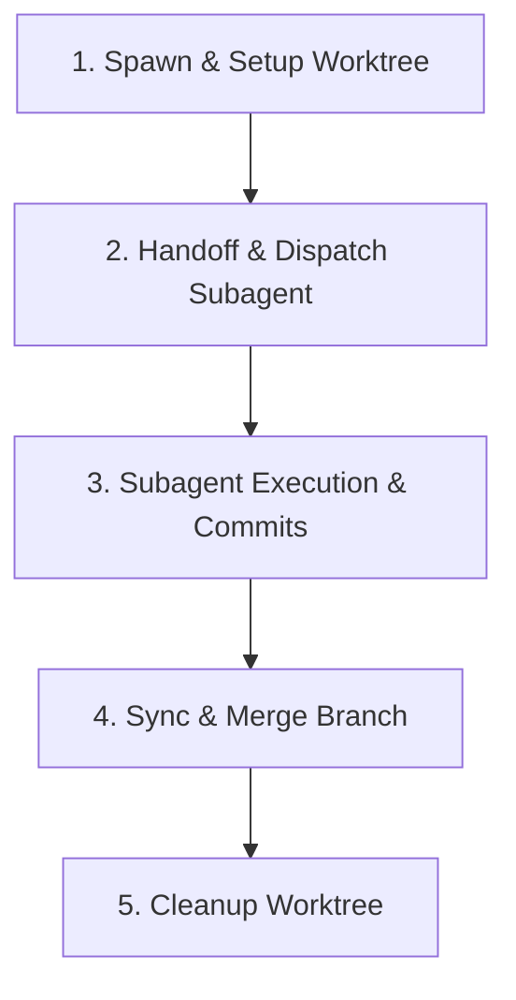

# Git Worktree & MCP Skill (`git-worktree`)

This skill defines the isolation protocol for running parallel agents in dedicated Git worktrees and the usage patterns for Git Model Context Protocol (MCP) servers.

---

## 🌲 1. Git Worktree Isolation Flow

When running multiple agents concurrently, we isolate their environments under `.worktrees/` in the project root to prevent index locks, dependency conflicts, and uncommitted change overrides.

### The Worktree Setup Function (Python Reference)

When setting up a worktree for a subagent, use the following logic (or implement it via a script/helper):

```python
import os
import subprocess

def setup_worktree(task_slug: str, branch_name: str) -> str:
    """
    Sets up a Git worktree for parallel agent execution.
    1. Ensures .gitignore contains .worktrees/
    2. Ensures .worktrees/ directory exists.
    3. Adds the worktree on the specified branch.
    Returns the absolute path to the created worktree.
    """
    workspace_root = os.getcwd()
    worktree_parent = os.path.join(workspace_root, ".worktrees")
    worktree_path = os.path.join(worktree_parent, task_slug)
    
    # 1. Ensure .worktrees/ is in .gitignore
    gitignore_path = os.path.join(workspace_root, ".gitignore")
    gitignore_entry = ".worktrees/\n"
    
    if os.path.exists(gitignore_path):
        with open(gitignore_path, "r") as f:
            content = f.read()
        if ".worktrees/" not in content:
            with open(gitignore_path, "a") as f:
                f.write("\n# Git worktrees for parallel agents\n" + gitignore_entry)
    else:
        with open(gitignore_path, "w") as f:
            f.write("# Git worktrees for parallel agents\n" + gitignore_entry)
            
    # 2. Ensure parent .worktrees/ directory exists
    os.makedirs(worktree_parent, exist_ok=True)
    
    # 3. Create the Git worktree
    # If the branch already exists, we check out to it; otherwise we create it
    try:
        # Check if branch exists
        subprocess.run(
            ["git", "show-ref", "--verify", f"refs/heads/{branch_name}"],
            check=True, stdout=subprocess.DEVNULL, stderr=subprocess.DEVNULL
        )
        # Branch exists, add worktree without '-b'
        print(f"Branch '{branch_name}' already exists. Adding worktree at '{worktree_path}'...")
        subprocess.run(
            ["git", "worktree", "add", worktree_path, branch_name],
            check=True
        )
    except subprocess.CalledProcessError:
        # Branch doesn't exist, create it with -b
        print(f"Creating branch '{branch_name}' and worktree at '{worktree_path}'...")
        subprocess.run(
            ["git", "worktree", "add", worktree_path, "-b", branch_name],
            check=True
        )
        
    return os.path.abspath(worktree_path)
```

---

## 🔄 2. Worktree Execution Lifecycle

The Orchestrator coordinates the worktree lifecycle across five distinct phases:



| Phase | Action | Commands / Steps |
| :--- | :--- | :--- |
| **1. Spawn** | Create worktree and branch | Call `setup_worktree(task_slug, branch_name)` |
| **2. Dispatch** | Initialize handoff metadata | Write `docs/handoffs/subagent_dispatch.md` in the worktree path with `branch_name` and `worktree_path` fields. |
| **3. Execute** | Subagent writes code | Subagent operates inside worktree directory. Stages and commits files locally using `caveman-commit`. |
| **4. Sync** | Merge changes back to main | Orchestrator runs `git merge <branch-name>` from the main repository. |
| **5. Clean** | Remove worktree and branch | Run `git worktree remove <worktree-path>` followed by `git branch -d <branch-name>`. |

---

## 🛠️ 3. Git MCP Server Integration

We leverage model-context tools to execute git actions programmatically.

### Local Git MCP Server (`mcp-server-git`)
* **Use Case**: Used strictly for the **current repository** (`ai-setup` or the active project stack).
* **Key Commands & Mappings**:
  * **Staging**: `git_add` - stage modified files before handoff.
  * **Committing**: `git_commit` - commit staged files using the Conventional Commits format (via the `caveman-commit` skill rules: brief subjects, concise explanations).
  * **Status**: `git_status` - verify dirty file status and clean working tree before starting task worktrees.
  * **History**: `git_log` - review commit history to trace parent state.

### Remote GitMCP (`gitmcp.io`)
* **Use Case**: Used to research or investigate public repositories, external frameworks, shared modules, or template configs.
* **Usage Rules**:
  * When a user requests to review or extract ideas/code from a public repository, convert it into an MCP server using `gitmcp.io`.
  * Do NOT clone remote templates manually. Query the remote GitMCP server to fetch only the files or directories needed.
  * *Authentication & Scope*: Remote GitMCP is read-only for public repositories unless explicit user access tokens are provided for remote writes.

---

## 👥 4. Parallel Execution Models

To support multiple agents running concurrently without conflict, we categorize worktree execution into two patterns:

### A. Delegated Subagents (Orchestrator-driven)
* **Setup**: Spawned by a parent Orchestrator. The parent creates the worktree and branches, then writes the `docs/handoffs/subagent_dispatch.md` file detailing the single-purpose scope and target persona.
* **Routing**: The subagent detects `subagent_dispatch.md` upon boot, bypasses standard classification, adopts the designated persona (e.g. `@engineer`), and executes the specific checklist.
* **Verification & Cleanup**: Once done, the subagent notifies the parent. The parent audits the diff, merges the branch, and removes the worktree.

### B. Independent Branch Agents (Feature-driven)
* **Setup**: Spawned directly on a dedicated worktree/branch by the user or an automated script, but without a parent dispatch card.
* **Routing**: Since no `subagent_dispatch.md` is found, the agent runs the standard request classifier and adopts the appropriate role for each prompt.
* **Lifecycle**: The agent executes the full 3-Stage Lifecycle (**Pre-coding** planning, **Coding** implementation, and **Post-coding** verification) locally on its branch.
* **Consolidation**: Once verification is complete, the branch is merged back to `main`, consolidating all plans and code additions.
