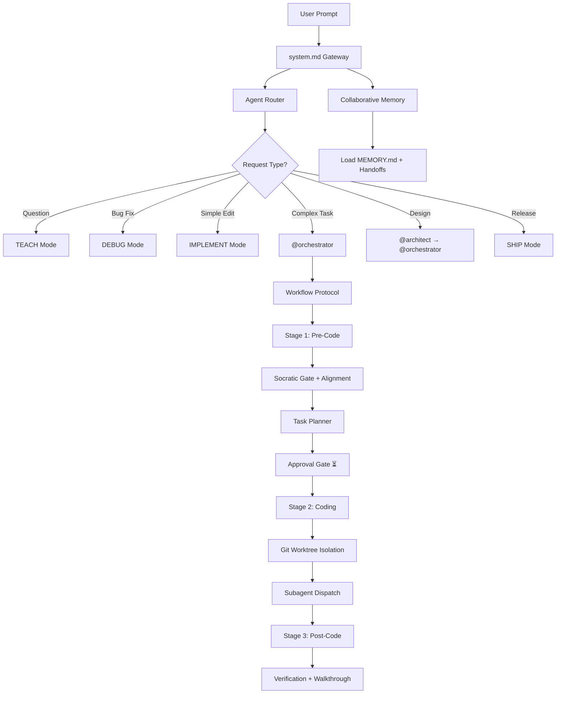

# AI Setup

> A modular, multi-agent workspace template that turns any AI coding assistant into a structured, memory-aware development team.

---

## What Is This?

**AI Setup** is a drop-in configuration framework for AI-powered code editors (Antigravity, Pi, Cursor, Windsurf, Claude Code, Gemini Code Assist, and others). It provides a composable set of **skills**, **personas**, **workflows**, and **memory systems** that transform a single-prompt AI assistant into a coordinated, multi-phase software engineering partner.

Instead of relying on ad-hoc prompts, AI Setup gives your agent:

- **Persistent memory** that survives across sessions
- **Specialized personas** (Architect, Engineer, Orchestrator, QA) that activate contextually
- **Structured workflows** with planning gates, approval checkpoints, and verification
- **Parallel execution** via Git worktree isolation
- **Token-efficient communication** modes that cut costs by up to 75%

---

## Quick Start

### 1. Bootstrap a New Project

Clone or copy this repository into your project root, then run:

```bash
python .agents/skills/agentic-code-start/scripts/bootstrap.py
```

This will scaffold all necessary directories (`docs/`, `.agents/personas/`, `.agents/workflows/`, etc.), create routing files for Cursor and Windsurf, and install locked skill dependencies.

### 2. Initialize the Documentation System

```bash
python .agents/skills/collaborative-memory/scripts/init_docs.py all
```

Can we created by AI.
This creates the full `docs/` folder structure (memory index, handoffs, specs, ADRs, test reports, audits, changelogs).

### 3. Start Coding

Open the project in your AI-powered editor. The agent reads `.agents/rules/system.md` on startup and auto-loads core skills, restores memory, and begins routing requests through the correct persona.

---

## Architecture Overview

```
ai-setup/
├── .agents/                    # Agent configuration root
│   ├── rules/
│   │   └── system.md           # Gateway rulebook — loaded on every session
│   ├── personas/               # Specialist role definitions
│   │   ├── architect.md
│   │   ├── engineer.md
│   │   ├── orchestrator.md
│   │   └── qa.md
│   ├── skills/                 # Modular capability packages (12 skills)
│   ├── workflows/              # Slash-command workflows (/verify)
│   ├── scripts/                # Bootstrap, environment, and template scripts
│   ├── agent-map.md            # Auto-generated registry of all personas & skills
│   └── mcp_config.json         # Model Context Protocol server configuration
├── docs/                       # Runtime state & engineering documentation (CMS)
│   ├── MEMORY.md               # Persistent memory index & pinned files
│   ├── project_profile.md      # Technical profile (domain, stack, rules)
│   ├── handoffs/               # Session handover tickets
│   ├── specs/                  # Functional specifications
│   ├── adr/                    # Architectural Decision Records
│   ├── plans/                  # Implementation plans & task trackers
│   ├── tests/                  # QA verification reports
│   ├── audits/                 # Security & session audit logs
│   └── changes/                # Changelogs & impact tracking
├── Taskfile.yml                # Task runner commands
├── skills-lock.json            # Locked external skill versions
├── .cursorrules                # Cursor IDE → system.md pointer
└── .windsurfrules              # Windsurf IDE → system.md pointer
```

---

## Cornerstones

The framework is built on **five pillars** that work together:

| Pillar | Purpose | Key Skills |
|:---|:---|:---|
| **Intelligent Routing** | Classify every request and activate the right persona automatically | `agent-router`, `map-generator` |
| **Alignment & Safety** | Prevent coding-before-understanding with Socratic gates and approval checkpoints | `alignment-protocol`, `workflow-protocol` |
| **Structured Execution** | Scale planning from 3-item checklists to full architectural blueprints | `task-planner`, `behavioral-modes` |
| **Persistent Memory** | Carry context, decisions, and handoffs across sessions and agents | `collaborative-memory` |
| **Parallel Isolation** | Run multiple agents on separate branches without conflicts | `git-worktree` |

---

## Skills Reference

### 🔀 Agent Router

> *Always active on startup*

The traffic controller. Silently analyzes every incoming prompt to determine its **type** (question, bug fix, simple edit, complex build, design, release) and **complexity**, then activates the appropriate persona and behavioral mode.

| Request Type | Behavioral Mode | Example Trigger |
|:---|:---|:---|
| Question | `TEACH` | "How does connection pooling work?" |
| Bug Fix | `DEBUG` | "Fix the auth middleware crash" |
| Simple Code | `IMPLEMENT` | "Add a loading spinner to the button" |
| Complex Code | `IMPLEMENT` | "Build a notification microservice" |
| Design / UI | `BRAINSTORM` | "Design the admin dashboard" |
| Release | `SHIP` | "Prepare for production deploy" |

For complex tasks, the router boots the `@orchestrator` persona and triggers the full workflow-protocol lifecycle.

---

### 🛑 Alignment Protocol

> *Always active on startup*

The guardrail system that prevents the agent from jumping to code before understanding the problem.

**Key mechanisms:**

- **Socratic Gate** — Pauses implementation on ambiguous requests. Asks 2-3 targeted questions (purpose, scope, edge cases) with structured options tables showing trade-offs. Saves resolved decisions to persistent memory.
- **Phase Transition Gate** — Requires explicit human approval ("proceed", "implement", "go ahead") before coding begins. Inline feedback and comments do **not** count as approval.
- **Status Board Reporting** — Standardized progress tables with `✅ 🔄 ⏳ ❌ ⚠️` status icons and concrete time estimates.
- **Error Recovery Flow** — On failure: acknowledge → explain → offer 2-3 recovery options → ask.
- **Completion Protocol** — Every task ends with: confirmation, file change summary, verification commands, and next-step suggestions.

---

### 🎭 Behavioral Modes

> *Dynamically activated by personas*

Six standardized communication layouts optimized for different development phases:

| Mode | When | Format |
|:---|:---|:---|
| **Brainstorm** | Architecture discussions | Options with pros/cons tables |
| **Implement** | Writing code | Code block + 1-2 sentence summary, no tutorials |
| **Debug** | Error tracing | Symptom → Root Cause → Fix → Prevention |
| **Review** | Code audits | 🔴 Critical / 🟠 Suggestions / 🟢 Positives |
| **Teach** | Explaining concepts | What is X? → How it Works (with examples) |
| **Ship** | Release prep | Pre-ship checklist with verification gates |

Also defines **multi-agent collaboration patterns**: Explore mode (read-only discovery), Plan-Execute-Critic cycle, and Mental Model Sync for subagent context passing.

---

### 🧠 Collaborative Memory System (CMS)

> *Active at session startup and during handoffs*

The shared blackboard for AI agents and human developers to synchronize state across sessions.

**What it manages:**

| Artifact | Location | Purpose |
|:---|:---|:---|
| Memory Index | `docs/MEMORY.md` | Pinned files list, past decisions, quick-access context |
| Project Profile | `docs/project_profile.md` | Domain, tech stack, build commands, architectural rules |
| Handoff Tickets | `docs/handoffs/` | Session state transfer (AI↔Human, AI↔AI) |
| Specifications | `docs/specs/` | Functional requirements with acceptance criteria |
| ADRs | `docs/adr/` | Architectural Decision Records with context & consequences |
| Test Reports | `docs/tests/` | QA execution results with coverage tables |
| Audit Logs | `docs/audits/` | Command logs, security gates, decision trail |
| Changelogs | `docs/changes/` | File modification tracking with impact analysis |

**Handoff types supported:**
- **AI → Human**: Blocked/completed state with outstanding questions
- **Human → AI**: Goal delegation with linked specs
- **AI → AI**: Stage transitions, subagent dispatch, and chat-to-chat context transfer

---

### 📋 Task Planner

> *Use for any multi-step implementation work*

A framework for breaking work into actionable, verifiable tasks — scaled to complexity:

| Scale | When | Output |
|:---|:---|:---|
| **Micro-Plan** | Single-file fix | 3-5 item checklist only |
| **Standard Plan** | Multi-file feature | Plan document + task tracker |
| **Architectural Plan** | Schema/API changes | Plan + API contracts + rollback strategy + regression risks |

Every task must have an explicit `Verify: [criteria/command]` step. Plans are living documents — minor adjustments happen inline, but scope drift triggers a human-in-the-loop gate with options.

Supports **subagent delegation** (annotated tasks dispatched to specialist agents) and **multi-agent role handoffs** (phase-based gates: Orchestrator → Architect → Engineer → QA).

---

### 🔄 Workflow Protocol

> *Used by the orchestrator for complex, multi-phase work*

The three-stage lifecycle that governs how complex tasks flow from idea to verified delivery:

```
┌─────────────────────┐    ┌─────────────────────┐    ┌─────────────────────┐
│  Stage 1: Pre-Code  │ →  │  Stage 2: Coding    │ →  │  Stage 3: Post-Code │
│                     │    │                     │    │                     │
│ • Analyze & discover│    │ • Execute milestones│    │ • Run tests/linters │
│ • Socratic gate     │    │ • Write code & docs │    │ • Generate walkthru │
│ • Plan & design     │    │ • Track progress    │    │ • Deliver report    │
│ • Await approval    │    │                     │    │                     │
└─────────────────────┘    └─────────────────────┘    └─────────────────────┘
```

Includes a **Session Resume Protocol** — on boot, the agent scans for in-progress plans and announces exactly where it's picking up. Also has an **Escape Hatch Rule** for off-topic questions: answers them cleanly, then returns to the active workflow.

---

### 🌲 Git Worktree

> *When managing branches or running parallel agents*

Enables multiple AI agents to work simultaneously without stepping on each other's changes by isolating them in dedicated Git worktrees.

**Execution lifecycle:**

1. **Spawn** — Create worktree under `.worktrees/<slug>` on a dedicated branch
2. **Dispatch** — Write subagent instructions to `subagent_dispatch.md`
3. **Execute** — Subagent operates in isolation, stages and commits locally
4. **Sync** — Orchestrator merges the branch back
5. **Clean** — Remove worktree and delete local branch

**Two execution models:**
- **Delegated Subagents** — Spawned by an orchestrator with a dispatch ticket; bypass standard routing
- **Independent Branch Agents** — User-spawned on a feature branch; run the full lifecycle locally

Integrates with **Git MCP servers** for programmatic git operations (staging, committing, status, history).

---

### 🦴 Caveman Mode

> *Triggered by "caveman mode", "be brief", or `/caveman`*

Ultra-compressed communication that cuts token usage by ~75% while preserving full technical accuracy. Strips articles, filler words, pleasantries, and hedging — keeps fragments, short synonyms, and exact technical terms.

**Six intensity levels:**

| Level | Style | Example |
|:---|:---|:---|
| `lite` | Professional but tight | "Your component re-renders because you create a new object reference each render." |
| `full` | Classic caveman (default) | "New object ref each render. Wrap in `useMemo`." |
| `ultra` | Maximum compression | "Inline obj prop → new ref → re-render. `useMemo`." |
| `wenyan-lite` | Semi-classical Chinese | 組件頻重繪，以每繪新生對象參照故。 |
| `wenyan-full` | Full classical Chinese | 每繪新生對象參照，故重繪；以 useMemo 包之則免。 |
| `wenyan-ultra` | Extreme classical compression | 新參照→重繪。useMemo Wrap。 |

**Safety auto-clarity:** Drops back to normal English for security warnings, irreversible actions, and ambiguous multi-step sequences.

---

### 🦴 Caveman Commit

> *Triggered when staging changes or by `/commit`*

Generates terse, precise commit messages in **Conventional Commits** format. Subject ≤ 50 chars, body only when the "why" isn't obvious.

```
feat(api): add GET /users/:id/profile

Mobile client needs profile data without the full user payload
to reduce LTE bandwidth on cold-launch screens.

Closes #128
```

Never includes filler ("This commit does X"), AI attribution, or emoji. Always includes body for breaking changes, security fixes, and data migrations.

---

### 🏗️ Agentic Code Start

> *Use when bootstrapping a new project*

The initialization skill. Copies standard templates (personas, workflows, rules, Taskfile, .gitignore) into a fresh repository, configures IDE routing files, and runs `npx skills update` to synchronize dependencies.

**Safety:** Never overwrites existing files with custom modifications — issues warnings instead.

---

### 🗺️ Map Generator

> *Auto-triggers when personas or skills change*

Keeps the central registry ([agent-map.md](.agents/agent-map.md)) synchronized by scanning all persona and skill frontmatter metadata. Run manually with:

```bash
task update-map
```

All personas must define `name`, `description`, and `skills` in their frontmatter. All skills must define `name`, `description`, and `when_to_use`.

---

### 🛠️ Skill Creator

> *Use when building, testing, or optimizing skills*

A meta-skill for creating new skills and iteratively improving them through structured evaluation loops:

1. **Capture intent** — Interview the user for purpose, triggers, and output format
2. **Draft the skill** — Write `SKILL.md` with proper frontmatter and instructions
3. **Test** — Spawn parallel with-skill and baseline runs on realistic prompts
4. **Evaluate** — Grade results with quantitative assertions + qualitative human review via built-in HTML viewer
5. **Iterate** — Improve based on feedback, re-run, repeat until satisfied
6. **Optimize** — Run description optimization loop for better triggering accuracy

Includes support for **blind A/B comparison**, **benchmark aggregation with variance analysis**, and **description optimization** using automated train/test splits.

---

## Personas

Four specialist personas activate contextually based on the agent router's classification:

| Persona | Role | Key Skills |
|:---|:---|:---|
| `@orchestrator` | Coordinates multi-agent workflows, plans, and validates results | `workflow-protocol`, `git-worktree` |
| `@architect` | Defines system designs, data schemas, and API layouts | `behavioral-modes` |
| `@engineer` | Implements logic, writes code, configures builds | `behavioral-modes`, `git-worktree` |
| `@qa` | Tests, verifies coverage, runs pre-ship checklists | `behavioral-modes` |

In **single-agent mode** (standard IDE), the agent adopts all personas sequentially: Plan → Design → Implement → Test → Review.

---

## Task Runner (Taskfile)

All automation is exposed through [Taskfile.yml](Taskfile.yml):

| Command | Description |
|:---|:---|
| `task env:init` | Set up development environment (Python venv + platform tools) |
| `task verify` | Run linting and verification checks |
| `task test` | Run test suite |
| `task update-map` | Regenerate agent-map.md from skill/persona metadata |
| `task handoff` | Compile current workspace state into a handoff ticket |
| `task docs:init` | Initialize the CMS documentation layout |
| `task worktree:create` | Create an isolated Git worktree for parallel work |
| `task worktree:clean` | Remove a worktree and delete its branch |
| `task worktree:list` | List all active worktrees |

---

## IDE Compatibility

AI Setup works across multiple AI-powered editors through a pointer-based loading system:

| IDE | Config File | How It Loads |
|:---|:---|:---|
| **Cursor** | `.cursorrules` | Points to `.agents/rules/system.md` |
| **Windsurf** | `.windsurfrules` | Points to `.agents/rules/system.md` |
| **Claude Code** | `.agents/rules/system.md` | Direct rule loading |
| **Antigravity** | `.agents/rules/system.md` | Direct rule loading |

The `system.md` file acts as the universal gateway — it loads mandatory startup skills, defines universal rules, and bootstraps the memory and routing systems.

---

## External Skill Dependencies

Three skills are sourced from external repositories and locked via [skills-lock.json](skills-lock.json):

| Skill | Source | Repository |
|:---|:---|:---|
| `caveman` | GitHub | [JuliusBrussee/caveman](https://github.com/JuliusBrussee/caveman) |
| `caveman-commit` | GitHub | [JuliusBrussee/caveman](https://github.com/JuliusBrussee/caveman) |
| `skill-creator` | GitHub | [anthropics/skills](https://github.com/anthropics/skills) |

All other skills are built-in and maintained within this repository.

---

## How It All Connects



---

## License

This project is provided as a workspace template. Feel free to fork, customize, and adapt it to your development workflow.
