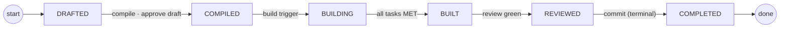
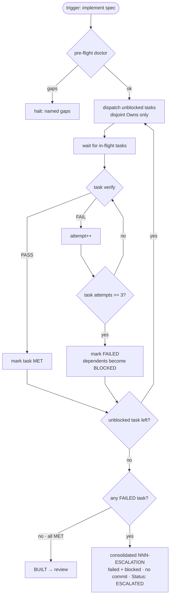
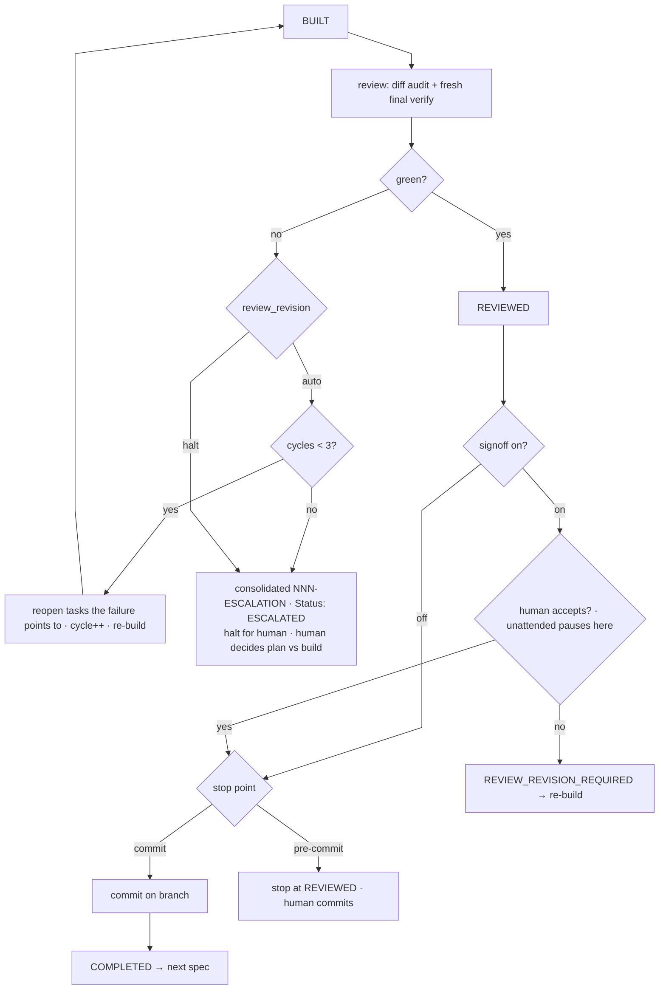
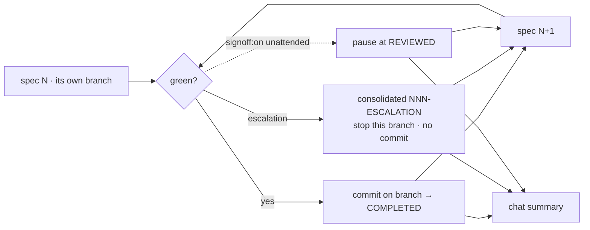
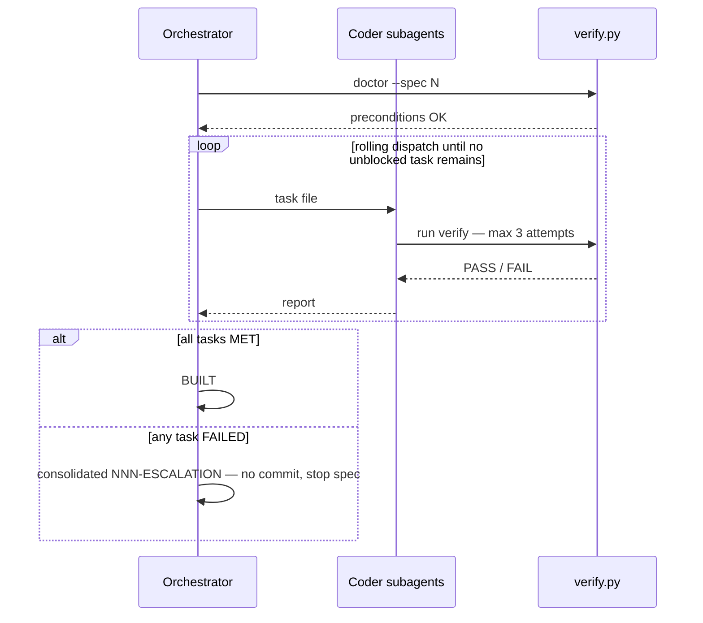

# Flow

The end-to-end flows of a run, as diagrams. Prose is kept short here — the *why* lives in the sibling topic docs (`lifecycle.md`, `task-files.md`, `verification.md`, `run-contract.md`, `branching.md`); this doc is the picture.

**Derived cross-cutting view.** The authoritative contracts are `lifecycle.md`, `task-files.md`, `verification.md`, `run-contract.md`, and `branching.md`; the diagrams below restate them and must be updated when an owning topic changes.

## Current State

### 1. Master per-spec state machine

**Related topics:** `lifecycle.md` (primary — statuses, gates, autonomy), `verification.md` (build-red/review-red and escalation), `branching.md` (commit and `ESCALATED` hand-back), `run-contract.md` (stop point and `signoff`).

The single `Status:` receipt moves through the happy path below — each state is a save point you can stop and resume from. Two distinct failure sources feed `ESCALATED` (`ABORTED` is reserved for a human deliberately stopping a spec): **build red** = a task exhausted its 3 attempts (`kind: build`); **review red** = every task passed but the combined result failed (`kind: review`). Only review red has the 3-cycle repair loop; build red exits straight to `ESCALATED`. The exception transitions (vetting block, build red, review red, signoff block, abort) are listed in the table after the diagram so the spine stays a straight line.

**Exception transitions** — the branches that leave the happy path:

| From | To | When |
| :--- | :--- | :--- |
| `DRAFTED` | `DRAFTED` | re-draft until plan-readiness is green |
| `DRAFTED` | `PLAN_REVISION_REQUIRED` | vetting blocks |
| `PLAN_REVISION_REQUIRED` | `DRAFTED` | fix · re-vet (3-try cap) |
| `PLAN_REVISION_REQUIRED` | `COMPILED` | accept as-is |
| `PLAN_REVISION_REQUIRED` | `ESCALATED` | cap hit |
| `PLAN_REVISION_REQUIRED` | `ABORTED` | human abort |
| `BUILDING` | `ESCALATED` | build red — any task exhausted its 3 attempts |
| `BUILT` | `BUILDING` | `review_revision: auto` fails (≤3 cycles) |
| `BUILT` | `ESCALATED` | review red — `auto` after 3 cycles, or `halt` |
| `REVIEWED` | `REVIEW_REVISION_REQUIRED` | `signoff: on` blocks at 4.5 |
| `REVIEW_REVISION_REQUIRED` | `BUILDING` | fix · re-build |
| `REVIEW_REVISION_REQUIRED` | `COMPLETED` | accept as-is |
| `REVIEW_REVISION_REQUIRED` | `ABORTED` | abort |

### 2. Build run flow (`COMPILED → BUILT | ESCALATED`)

**Related topics:** `verification.md` (primary — run-to-exhaustion, evidence, doctor), `task-files.md` (rolling dispatch and disjoint `Owns`), `run-contract.md` (explicit trigger and stop point).

The build is **run-to-exhaustion**: a task that exhausts its 3 attempts is `FAILED`, its dependents become `BLOCKED`, and every independent task still runs. Only when no unblocked task remains is the outcome decided — all `MET` → `BUILT`, otherwise one consolidated `NNN-ESCALATION` and the spec halts as `ESCALATED`. There is no "3 consecutive failed tasks" breaker.

### 3. Review & acceptance (`BUILT → REVIEWED → commit → COMPLETED`)

**Related topics:** `lifecycle.md` (primary — `REVIEWED`/sign-off states), `verification.md` (report and review outcomes), `branching.md` (commit on the spec branch), `run-contract.md` (stop point and unattended pause).

A review failure is a **plan-level signal**: `review_revision: auto` allows up to 3 re-build cycles, `halt` goes straight to the human; either way the terminal state is `ESCALATED` + human intervention. `signoff: on` makes the human decide at `REVIEWED`; in `unattended` mode it **pauses at 4.5**. The verification ladder is two levels: per-task verify (3-attempt limit) inside the build, then review (fresh re-run of every task + canonical commands + diff audit) — only level 2 sees the tasks combined.

### 4. Multi-spec + escalation

**Related topics:** `branching.md` (primary — per-spec branch, batch continues, never-merge), `verification.md` (consolidated `NNN-ESCALATION`), `lifecycle.md` (`ESCALATED`/`ABORTED`), `run-contract.md` (batch targets and stop point).

The run is **commit-terminal**: a green spec commits on its own branch and is `COMPLETED` immediately (no post-commit checks); a `signoff: on` spec pauses at `REVIEWED`; an escalation stops only that spec's branch and the batch **continues**. Reports are per spec only; the batch ends with a chat summary. The run never merges to the default/release branch (hard guardrail).

### 5. Build loop (orchestrator / coders / verify)

**Related topics:** `run-contract.md` (primary — trigger, mode, rolling dispatch), `task-files.md` (task files, ownership, progress), `verification.md` (`verify.py` and the 3-attempt budget).

Identical for supervised and unattended — the only difference is whether a `signoff: on` spec pauses for a human at 4.5.

## Decision Log

### FLOW-D01 - Flow diagrams centralized as the end-to-end view
- **Date:** 2026-10-18
- **Why:** The flows are cross-cutting — the build loop spans `task-files.md`, `verification.md`, and `run-contract.md`, and multi-spec escalation spans `branching.md`, `lifecycle.md`, and `verification.md` — so no single topic owns them. One `flow.md` gives a newcomer the whole run in one place, while the topic docs remain authoritative and each diagram names the topics it relates to.
