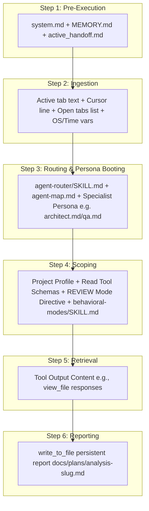

# SPEC-001b: ANALYSIS Path Context Trace

- **Status**: Approved
- **Author**: @orchestrator
- **Created**: 2026-06-24
- **Parent Spec**: [SPEC-001: Agent Context & Routing](index.md)

## 1. Overview
Trace of what is loaded in the AI context when evaluating or auditing folders, architecture, or codebases (e.g., "analyze", "deep dive", "audit", "review").

## 2. Detailed Context Loading Lifecycle

### Step 1: Pre-Execution & Rule Bootstrapping
Before evaluating the request text, the backend initializes system guidelines and queries the workspace's memory state.

*   **Newly Loaded Context**:
    *   **Workspace Gateway Rules**: Ingests [system.md](/.agents/rules/system.md) as the `<user_rules>` block.
    *   **Memory Index**: Reads [MEMORY.md](/docs/MEMORY.md) to locate pinned files and directories.
    *   **Handoff State**: Ingests [active_handoff.md](/docs/handoffs/active_handoff.md) to check for pending session transfer states.

---

### Step 2: Client Metadata Ingestion
The IDE packages the active editor state metadata and user environment details to provide local context.

*   **Newly Loaded Context**:
    *   **Target Scope variables**: Active file path, current tab content slice, and highlighted text selection.
    *   **Cursor Position Variable**: `Cursor is on line: <line_number>`.
    *   **Editor open documents array**: `['<open_file_a.ext>', '<open_file_b.ext>']`.
    *   **System Environment Variables**: OS Type (`windows`/`linux`), local time, and workspace root directory.

---

### Step 3: Classification & Persona Booting
The system initializes the router to match query keywords (e.g., *"analyze"*, *"deep dive"*, *"audit"*, *"review"*) to a routing path.

*   **Newly Loaded Context**:
    *   **Router Instructions**: Loads [.agents/skills/agent-router/SKILL.md](/.agents/skills/agent-router/SKILL.md).
    *   **Workspace Map**: Reads [.agents/agent-map.md](/.agents/agent-map.md) to discover available roles.
*   **Persona Selection**: The request is routed to the **ANALYSIS** path. The system dynamically determines the code domain and **boots a specialist persona** from [.agents/personas/](/.agents/personas/):
    *   **`@architect`**: If the request targets system design, API schemas, or data structures.
    *   **`@qa`**: If the request targets test coverage, reliability, or quality audits.
    *   **`@engineer`**: If the request targets code readability, style guides, or refactoring.
    The selected persona prompt is appended to the context.

---

### Step 4: Scoping & API Invocation
The backend configures tool restrictions and injects the `REVIEW` mode formatting guidelines.

*   **Newly Loaded Context**:
    *   **System Prompt**: The baseline persona instructions of the selected specialist (e.g. `@architect` or `@qa`).
    *   **Project Profile**: Reads [project_profile.md](/docs/project_profile.md) to extract the workspace's domain, tech stack, and architectural rules.
    *   **Tool Schema Restrictions**: Exposes **read-only** schemas (`view_file`, `grep_search`, `list_dir`, `search_web`) and **file-writing** schemas (to write persistent reports). Code modification tool schemas (like `replace_file_content`) are disabled.
    *   **Behavioral Mode Rules**: Loads [.agents/skills/behavioral-modes/SKILL.md](/.agents/skills/behavioral-modes/SKILL.md) formatting rules.
        *   **Standard Code Audits**: Adapts to `REVIEW` mode (structured based on [review.md](/.agents/skills/behavioral-modes/templates/review.md) containing `🔴 Critical Issues`, `🟠 Refactoring Suggestions`, and `🟢 Positive Observations`).
        *   **Larger-Scale/Systemic Analysis**: Since analysis can be broader and more complex than code quality audits (e.g. system design reviews, feasibility studies, threat modeling, or codebase exploration), the system can dynamically switch to `BRAINSTORM` mode (for trade-off tables) or adopt custom structured report templates to fit the wider scope.

---

### Step 5: Retrieval Loop (On-Demand)
The specialist persona executes read and search tools to compile architectural facts and trace code patterns.

*   **Newly Loaded Context**:
    *   **Tool Output Context**: Appends content returned by `view_file` or search logs directly into the LLM context.

---

### Step 6: Reporting & Rendering
The specialist compiles the audit findings into a persistent document.

*   **Newly Loaded Context**:
    *   **Persistent Report creation**: The agent writes the review directly into a version-controlled file (e.g. `/docs/plans/analysis-{slug}.md`) using `write_to_file`.
    *   **Client Rendering**: The client parses the output, rendering the report path as a clickable absolute link. No new data is added to the LLM context.

---

> [!NOTE]
> **Traditional Agent Difference**:
> A traditional agent prints a massive wall of text directly into the chat pane instead of saving findings to a persistent, version-controlled workspace file (like `docs/plans/analysis-{slug}.md`). This causes that analysis to be lost as soon as the chat history rolls over.
