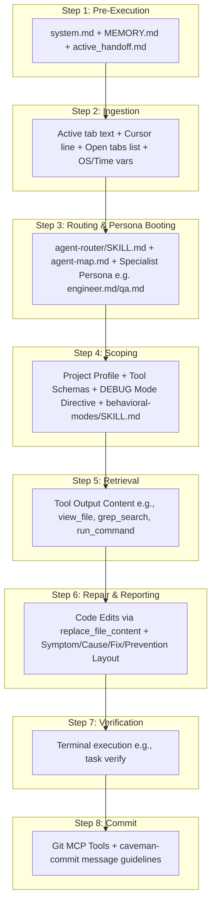

# SPEC-001c: BUG FIX Path Context Trace

- **Status**: Approved
- **Author**: @orchestrator
- **Created**: 2026-06-24
- **Parent Spec**: [SPEC-001: Agent Context & Routing](index.md)


## 1. Overview
Trace of what is loaded in the AI context when identifying, debugging, or fixing software errors (e.g., "fix", "debug", "error", "fails", "crash").

## 2. Detailed Context Loading Lifecycle



### Step 1: Pre-Execution & Rule Bootstrapping
Before evaluating the user's prompt text, the backend initializes the core system guidelines to retrieve workspace memory and restore execution state.

*   **Newly Loaded Context**:
    *   **Workspace Gateway Rules**: Appends [.agents/rules/system.md](/.agents/rules/system.md) as the `<user_rules>` block.
    *   **Memory Index**: Reads [docs/MEMORY.md](/docs/MEMORY.md) to discover currently pinned project files.
    *   **Handoff State**: Reads [docs/handoffs/active_handoff.md](/docs/handoffs/active_handoff.md) to check if the session was left in a pending or blocked state.
    *   **Global Rules**: Loads `AGENTS.md` (if configured in user home directory).

---

### Step 2: Client Metadata Ingestion
The IDE packages the active editor state metadata and local environment variables.

*   **Newly Loaded Context**:
    *   **Target Scope Variables**: Active file path, current tab content slice, and highlighted text selection.
    *   **Cursor Position Variable**: `Cursor is on line: <line_number>`.
    *   **Editor Open Documents Array**: Currently open tabs in the editor (e.g. `['<open_file_a.ext>', '<open_file_b.ext>']`).
    *   **System Environment Variables**: OS Type (`windows`/`linux`), local time, and workspace root directory.

---

### Step 3: Classification & Persona Booting
The system initializes the request classifier to scan prompt keywords and boot the correct persona.

*   **Newly Loaded Context**:
    *   **Router Instructions**: Loads [.agents/skills/agent-router/SKILL.md](/.agents/skills/agent-router/SKILL.md).
    *   **Workspace Agent Map**: Reads [.agents/agent-map.md](/.agents/agent-map.md) to parse available roles and skills.
*   **Persona Selection**: The request is routed to the **BUG FIX** path. The system dynamically resolves the affected code domain and boots a specialist persona from [.agents/personas/](/.agents/personas/):
    *   **`@engineer`**: If resolving standard code logic or compilation issues. Loads skills: `behavioral-modes` and `git-worktree`.
    *   **`@qa`**: If the issue targets test validation, security scans, lint blockers, or coverage audits. Loads skills: `behavioral-modes`.
*   **Trigger Notification Banner**: The agent informs the user of the resolved persona and request type using the banner:
    ```markdown
    🤖 **Applying knowledge of `@[persona-name]` (BUG FIX)...**
    ```

---

### Step 4: Scoping & API Invocation
The backend configures tool schemas and sets behavioral constraints before invoking the LLM.

*   **Newly Loaded Context**:
    *   **System Prompt**: Injects the active specialist persona rules.
    *   **Project Profile**: Reads [project_profile.md](/docs/project_profile.md) (if it exists) to extract the workspace's domain, tech stack, and architectural rules.
    *   **Tool Schema Restrictions**: Exposes **both** read tools (`view_file`, `grep_search`, `list_dir`) and modification/execution tools (`replace_file_content`, `run_command`, `write_to_file`).
    *   **Behavioral Mode Instructions**: Injects instructions directing the LLM to adopt `DEBUG` mode.
    *   **Behavioral Modes Formatting**: Loads [.agents/skills/behavioral-modes/SKILL.md](/.agents/skills/behavioral-modes/SKILL.md) and imports the `DEBUG` layout template from [.agents/skills/behavioral-modes/templates/debug.md](/.agents/skills/behavioral-modes/templates/debug.md).

---

### Step 5: Investigation & Retrieval (On-Demand)
The booted persona runs tools to inspect files, search patterns, or run commands to isolate the root cause.

*   **Newly Loaded Context**:
    *   **Tool Output Context**: Appends text returned by execution tools (such as build trace logs from a `run_command` run, file snippets from `view_file` calls, or ripgrep matches from `grep_search`).

---

### Step 6: Repair & Reporting
The agent designs the fix, modifies code, and reports the findings.

*   **Execution**:
    *   **Code Modification Tooling**: Changes are proposed and executed using `replace_file_content` (preferring single contiguous chunk edits to save token bandwidth).
    *   **Structured Reply Layout**: The agent outputs a debug report structured according to the `DEBUG` mode layout:
        *   **Symptom**: Description of the observed error, failure, or crash.
        *   **Root Cause**: Under-the-hood explanation of why the failure occurred.
        *   **Fix**: Resolution steps and/or code modification details.
        *   **Prevention**: Steps taken or checks added to prevent future regression.

---

### Step 7: Verification & Testing
> **Lifecycle Stage**: Inline verification (does **not** activate the full [SPEC-002](../workflow-protocol/index.md) lifecycle — no formal Stage 1 planning gate)

The persona validates the changes to ensure they compile and pass all test suites.

*   **Execution**:
    *   Runs the workspace verification command (e.g. `task verify` or `task test` as defined in [Taskfile.yml](/Taskfile.yml)).
    *   If checks fail, the loop repeats from **Step 5** until everything passes.

---

### Step 8: Version Control & Commit
The agent commits the verified changes to version control.

*   **Execution**:
    *   Stages modified files.
    *   Generates a concise commit message following Conventional Commits using the rules in the [caveman-commit](/.agents/skills/caveman-commit/SKILL.md) skill (e.g., `fix(domain): describe fix`).
    *   Commits to the branch.

---

> [!NOTE]
> **Traditional Agent Difference**:
> A traditional agent immediately starts changing lines of code without explaining the root cause or documenting prevention. It does not follow a structured layout like **Symptom/Cause/Fix/Prevention**, nor does it guarantee verification check runs (e.g., `task verify`) or generate Conventional Commits. This makes code reviews slower and increases the risk of regressions.
