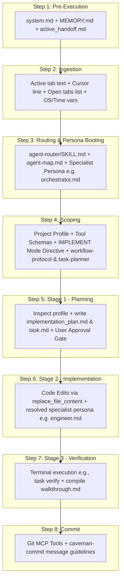

# SPEC-001e: COMPLEX CODE Path Context Trace

- **Status**: Approved
- **Author**: @orchestrator
- **Created**: 2026-06-24
- **Parent Spec**: [SPEC-001: Agent Context & Routing](index.md)


## 1. Overview
Trace of what is loaded in the AI context when implementing multi-file refactoring, new features, or codebase expansions (e.g. "build", "create", "implement", "refactor").

## 2. Detailed Context Loading Lifecycle



### Step 1: Pre-Execution & Rule Bootstrapping
Before evaluating the user's prompt text, the backend initializes the core system guidelines to retrieve workspace memory and restore execution state.

*   **Newly Loaded Context**:
    *   **Workspace Gateway Rules**: Appends [.agents/rules/system.md](/.agents/rules/system.md) as the `<user_rules>` block.
    *   **Memory Index**: Reads [docs/MEMORY.md](/docs/MEMORY.md) to discover currently pinned project files.
    *   **Handoff State**: Reads [docs/handoffs/active_handoff.md](/docs/handoffs/active_handoff.md) to check if the session was left in a pending or blocked state.
    *   **Global Rules**: Loads `AGENTS.md` (if configured in user home directory).

---

### Step 2: Client Metadata Ingestion
The IDE packages the active editor state metadata and local environment variables.

*   **Newly Loaded Context**:
    *   **Target Scope Variables**: Active file path, current tab content slice, and highlighted text selection.
    *   **Cursor Position Variable**: `Cursor is on line: <line_number>`.
    *   **Editor Open Documents Array**: Currently open tabs in the editor (e.g. `['<open_file_a.ext>', '<open_file_b.ext>']`).
    *   **System Environment Variables**: OS Type (`windows`/`linux`), local time, and workspace root directory.

---

### Step 3: Classification & Persona Booting
The system initializes the request classifier to scan prompt keywords and boot the coordinator.

*   **Newly Loaded Context**:
    *   **Router Instructions**: Loads [.agents/skills/agent-router/SKILL.md](/.agents/skills/agent-router/SKILL.md).
    *   **Workspace Agent Map**: Reads [.agents/agent-map.md](/.agents/agent-map.md) to parse available roles.
*   **Persona Selection**: The request is routed to the **COMPLEX CODE** path. The system boots the coordinator persona:
    *   **`@orchestrator`**: Boots [.agents/personas/orchestrator.md](/.agents/personas/orchestrator.md) (with `git-worktree`, `behavioral-modes`, and `workflow-protocol` skills).
*   **Trigger Notification Banner**: The agent informs the user of the resolved persona and request type using the banner:
    ```markdown
    🤖 **Applying knowledge of `@orchestrator` (COMPLEX CODE)...**
    ```

---

### Step 4: Scoping & API Invocation (Stage 1 / Planning Turn)
The backend configures tool schemas and sets behavioral constraints for the initial planning turn.

*   Newly Loaded Context:
    *   System Prompt: Injects `@orchestrator` coordinator rules.
    *   Planning Guidelines: Loads [.agents/skills/workflow-protocol/SKILL.md](/.agents/skills/workflow-protocol/SKILL.md) and [.agents/skills/task-planner/SKILL.md](/.agents/skills/task-planner/SKILL.md).
    *   **Plan Mode Lock**: For this initial planning turn, the backend strips all code-modification tools (such as `replace_file_content` or `multi_replace_file_content`) from the tool schema definitions exposed to the LLM. Only read-only tools and plan-writing tools (`write_to_file`) are enabled.
    *   Behavioral Mode Instructions: Injects instructions directing the LLM to adopt `IMPLEMENT` mode (or `BRAINSTORM` if architectural trade-offs are required).

---

### Step 5: Stage 1 - Pre-coding Phase (Planning & Design Approval)
> **Lifecycle Stage**: [SPEC-002a: Stage 1 Pre-coding](../workflow-protocol/stage-1-pre-coding.md)

The `@orchestrator` inspects the workspace, retrieves memory, and drafts the implementation plan under the restricted planning tool schema.

*   Execution:
    *   Inspect Workspace: Queries [project_profile.md](/docs/project_profile.md) and maps out directories/dependencies using read tools.
    *   Socratic alignment check: If requirements are vague or ambiguous, the orchestrator loads [alignment-protocol](/.agents/skills/alignment-protocol/SKILL.md) to ask clarifying questions first.
    *   Plan Drafting: Writes the implementation plan to `docs/plans/implementation_plan-{slug}.md` and the checklist to `docs/plans/task-{slug}.md` (in standard IDEs, writes to the session artifacts [implementation_plan.md](/docs/plans/implementation_plan.md) and [task.md](/docs/plans/task.md)).
    *   **Approval Gate (Iterative Feedback Loop)**: Pauses execution and awaits user approval. If the user requests design changes, asks questions, or provides feedback, the workflow loops within Stage 1 (remaining under the **Plan Mode Lock**), researching and updating the plan files as needed. This feedback loop continues iteratively until the human sends an explicit proceed signal.

---

### Step 6: Stage 2 - Coding Phase (Implementation Turn)
> **Lifecycle Stage**: [SPEC-002b: Stage 2 Coding](../workflow-protocol/stage-2-coding.md)

Once the plan is approved, the backend initiates a new API invocation for the implementation phase, updating the tool schema.

*   Execution:
    *   **Unlock Modification Tools**: Re-invokes the API with an updated tool schema that enables `replace_file_content` and other code-editing tools in the LLM context, alongside the resolved specialist personas.
    *   **Persona Delegation**: Dynamically adopts or delegates tasks to the specialist persona (e.g. [@engineer](/.agents/personas/engineer.md) for code logic or [@architect](/.agents/personas/architect.md) for API contracts).
    *   **Execute Checklists**: Sequentially works through `docs/plans/task-{slug}.md`, marking in-progress tasks as `[/]` and completed tasks as `[x]`.
    *   **Plan Mutation Guardrails (Safety Switch)**: If a step fails, a dependency cannot be installed, or the approved plan is found to be unviable:
        *   The agent is strictly **forbidden** from writing code under unapproved assumptions or going rogue.
        *   It must **stop execution** immediately and return control to the user.
        *   It must **report the failure details and explain the reason** clearly.
        *   It must **propose possible solution paths or alternative designs** with pros/cons, and await explicit planning approval before modifying files or resuming work.

---

### Step 7: Stage 3 - Post-coding Phase (Verification)
> **Lifecycle Stage**: [SPEC-002c: Stage 3 Post-coding](../workflow-protocol/stage-3-post-coding.md)

The agent verifies the correctness of the changes and compiles validation results.

*   **Execution**:
    *   Runs automated verification commands (e.g. `task verify` or test suites as defined in [Taskfile.yml](/Taskfile.yml)).
    *   Generates a walkthrough report at `docs/plans/walkthrough-{slug}.md` (or [walkthrough.md](/docs/plans/walkthrough.md) in the session artifacts) detailing the registry of changed files, test output logs, and a clean-code self-review.

---

### Step 8: Version Control & Commit
The verified changes are staged and committed to version control.

*   **Execution**:
    *   Stages modified files.
    *   Generates a conventional commit message (using `caveman-commit` skill rules if active).
    *   Commits the changes.

---

> [!NOTE]
> **Traditional Agent Difference**:
> A traditional agent immediately edits multiple files sequentially without a plan, checklist, or design approval. If compilation breaks midway, it has no record of progress and will begin hallucinating, forcing you to manually revert the git branch.
