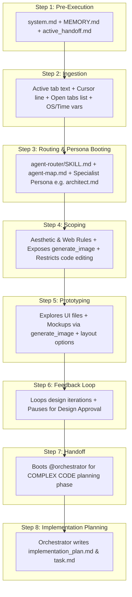

# SPEC-001f: DESIGN/UI Path Context Trace

- **Status**: Approved
- **Author**: @orchestrator
- **Created**: 2026-06-24
- **Parent Spec**: [SPEC-001: Agent Context & Routing](index.md)


## 1. Overview
Trace of what is loaded in the AI context when designing pages, dashboards, assets, or visual flows (e.g. "design", "UI", "page", "dashboard").

## 2. Detailed Context Loading Lifecycle



### Step 1: Pre-Execution & Rule Bootstrapping
Before evaluating the user's prompt text, the backend initializes the core system guidelines to retrieve workspace memory and restore execution state.

*   **Newly Loaded Context**:
    *   **Workspace Gateway Rules**: Appends [.agents/rules/system.md](/.agents/rules/system.md) as the `<user_rules>` block.
    *   **Memory Index**: Reads [docs/MEMORY.md](/docs/MEMORY.md) to discover currently pinned project files.
    *   **Handoff State**: Reads [docs/handoffs/active_handoff.md](/docs/handoffs/active_handoff.md) to check if the session was left in a pending or blocked state.
    *   **Global Rules**: Loads `AGENTS.md` (if configured in user home directory).

---

### Step 2: Client Metadata Ingestion
The IDE packages the active editor state metadata and local environment variables.

*   **Newly Loaded Context**:
    *   **Target Scope Variables**: Active file path, current tab content slice, and highlighted text selection.
    *   **Cursor Position Variable**: `Cursor is on line: <line_number>`.
    *   **Editor Open Documents Array**: Currently open tabs in the editor (e.g. `['<open_file_a.ext>', '<open_file_b.ext>']`).
    *   **System Environment Variables**: OS Type (`windows`/`linux`), local time, and workspace root directory.

---

### Step 3: Classification & Persona Booting
The system initializes the request classifier to scan prompt keywords and boot the architect.

*   **Newly Loaded Context**:
    *   **Router Instructions**: Loads [.agents/skills/agent-router/SKILL.md](/.agents/skills/agent-router/SKILL.md).
    *   **Workspace Agent Map**: Reads [.agents/agent-map.md](/.agents/agent-map.md) to parse available roles.
*   **Persona Selection**: The request is routed to the **DESIGN/UI** path. The system boots the architect persona:
    *   **`@architect`**: Boots [.agents/personas/architect.md](/.agents/personas/architect.md) (with `behavioral-modes` skill).
*   **Trigger Notification Banner**: The agent informs the user of the resolved persona and request type using the banner:
    ```markdown
    🤖 **Applying knowledge of `@architect` (DESIGN/UI)...**
    ```

---

### Step 4: Scoping & API Invocation
The backend configures tool schemas, behavioral constraints, and injects styling rules.

*   **Newly Loaded Context**:
    *   **System Prompt**: Injects `@architect` rules, which contain a hard boundary: *forbidden from implementing active application source code*.
    *   **Aesthetic & Web Development Rules**: Loads core visual guidelines (typography, glassmorphism, responsive grids, custom harmonious color palettes, Google Fonts, and SEO rules) into the LLM context.
    *   **Tool Schema Definitions**: Exposes the `generate_image` tool schema for mockup and asset creation. Source-code editing tools (like `replace_file_content` or `multi_replace_file_content`) are disabled.
    *   **Behavioral Mode Instructions**: Injects instructions directing the LLM to adopt `BRAINSTORM` mode.

---

### Step 5: Design & Mockup Prototyping
> **Lifecycle Stage**: [SPEC-002a: Stage 1 Pre-coding](../workflow-protocol/stage-1-pre-coding.md) (Design sub-phase)

The `@architect` explores the codebase structure and generates mockup assets.

*   **Execution**:
    *   **Explore Codebase**: Reads current styling and structure files (`index.css`, `index.html`) using read-only tools.
    *   **Generate Mockups**: Uses `generate_image` to create visual mockups of the proposed interface (saved to the session artifacts directory).
    *   **Formulate Schemas**: Designs CSS class tokens, layout hierarchies, HSL color palettes, responsive rules, and presents these specifications to the user in comparison/design options tables.

---

### Step 6: Iterative Feedback Loop & Approval Gate
> **Lifecycle Stage**: [SPEC-002a: Stage 1 Pre-coding](../workflow-protocol/stage-1-pre-coding.md) (Approval sub-phase)

The architect iterates on design specifications and mockups with the user.

*   **Execution**:
    *   **Feedback Iteration**: If the user requests tweaks (e.g., *"Make it dark mode by default"*, *"Increase contrast on buttons"*), the `@architect` regenerates mockups and updates design specs.
    *   **Approval Gate**: Pauses execution and awaits explicit user approval of the design assets and schemas before moving to the implementation phase.

---

### Step 7: Handoff to Orchestrator (Transition to Planning)
> **Lifecycle Stage**: Transition — hands off to [SPEC-002a: Stage 1 Pre-coding](../workflow-protocol/stage-1-pre-coding.md) → Planning sub-phase

Once approved, the `@architect` compiles the design state and hands over the context to the coordinator.

*   **Execution**:
    *   **State Serialization**: Compiles the approved layout tokens, image paths, and specs.
    *   **Handoff**: Set active handoff target to `@orchestrator` in `docs/handoffs/active_handoff.md`.
    *   **Boot Orchestrator**: The system boots the [@orchestrator](/.agents/personas/orchestrator.md) persona and transitions to the **COMPLEX CODE** path to map out implementation.

---

### Step 8: Implementation Planning
> **Lifecycle Stage**: [SPEC-002a: Stage 1 Pre-coding](../workflow-protocol/stage-1-pre-coding.md) (Plan & Solution Design)

The `@orchestrator` drafts the coding plan to implement the approved designs.

*   **Execution**:
    *   Writes `docs/plans/implementation_plan-{slug}.md` and `docs/plans/task-{slug}.md` checklists containing step-by-step tasks to implement the stylesheets, markup, and logic.

---

> [!NOTE]
> **Traditional Agent Difference**:
> Traditional agents render standard HTML templates with browser defaults and plain colors (e.g., standard red/blue/green button colors). They do not generate image mocks or split the design approval phase from the coding phase. This results in basic, uninspired interfaces that fail to meet modern aesthetic standards.
