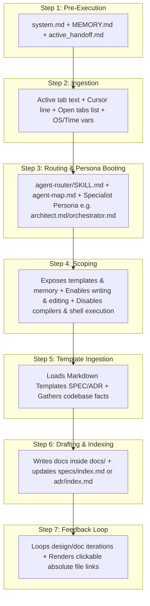

# SPEC-001i: DOCUMENTATION Path Context Trace

- **Status**: Approved
- **Author**: @orchestrator
- **Created**: 2026-06-24
- **Parent Spec**: [SPEC-001: Agent Context & Routing](index.md)


## 1. Overview
Trace of what is loaded in the AI context when drafting, editing, or auditing repository documentation, specifications, or decision logs (e.g. "write readme", "document this", "write SPEC", "generate changelog", "write ADR").

## 2. Detailed Context Loading Lifecycle



### Step 1: Pre-Execution & Rule Bootstrapping
Before evaluating the user's prompt text, the backend initializes the core system guidelines to retrieve workspace memory and restore execution state.

*   **Newly Loaded Context**:
    *   **Workspace Gateway Rules**: Appends [.agents/rules/system.md](/.agents/rules/system.md) as the `<user_rules>` block.
    *   **Memory Index**: Reads [docs/MEMORY.md](/docs/MEMORY.md) to discover currently pinned project files.
    *   **Handoff State**: Reads [docs/handoffs/active_handoff.md](/docs/handoffs/active_handoff.md) to check if the session was left in a pending or blocked state.
    *   **Global Rules**: Loads `AGENTS.md` (if configured in user home directory).

---

### Step 2: Client Metadata Ingestion
The IDE packages the active editor state metadata and local environment variables.

*   **Newly Loaded Context**:
    *   **Target Scope Variables**: Active file path, current tab content slice, and highlighted text selection.
    *   **Cursor Position Variable**: `Cursor is on line: <line_number>`.
    *   **Editor Open Documents Array**: Currently open tabs in the editor (e.g. `['<open_file_a.ext>', '<open_file_b.ext>']`).
    *   **System Environment Variables**: OS Type (`windows`/`linux`), local time, and workspace root directory.

---

### Step 3: Classification & Persona Booting
The system initializes the request classifier to scan prompt keywords and boot the appropriate persona.

*   **Newly Loaded Context**:
    *   **Router Instructions**: Loads [.agents/skills/agent-router/SKILL.md](/.agents/skills/agent-router/SKILL.md).
    *   **Workspace Agent Map**: Reads [.agents/agent-map.md](/.agents/agent-map.md) to parse available roles.
*   **Persona Selection**: The request is routed to the **DOCUMENTATION** path. The system boots the persona in its documentation capacity:
    *   **`@architect`**: If drafting Architectural Decision Records (ADRs) or high-level design specifications.
    *   **`@orchestrator`**: If drafting functional specifications, execution plans, or checklists.
    *   **`@engineer`**: If drafting local READMEs, changelogs, inline docstrings, or API documentation.
*   **Trigger Notification Banner**: The agent informs the user of the resolved persona and request type using the banner:
    ```markdown
    🤖 **Applying knowledge of `@[persona-name]` (DOCUMENTATION)...**
    ```

---

### Step 4: Scoping & API Invocation
The backend configures tool schemas and sets behavioral constraints.

*   **Newly Loaded Context**:
    *   **System Prompt**: Injects the active specialist persona rules.
    *   **Collaborative Memory Guidelines**: Loads [.agents/skills/collaborative-memory/SKILL.md](/.agents/skills/collaborative-memory/SKILL.md) which contains Markdown rules and templates.
    *   **Tool Schema Restrictions**: Exposes **only** read tools (`view_file`, `grep_search`, `list_dir`) and file-writing/editing tools (`write_to_file`, `replace_file_content`, `multi_replace_file_content`). Terminal execution schemas (like `run_command`) are disabled.
    *   **Behavioral Mode Instructions**: Injects instructions directing the LLM to adopt `TEACH` mode (for manuals and guides) or `REVIEW` mode (for auditing spec files).

---

### Step 5: Reference & Template Loading
The agent retrieves standard templates and gathers codebase facts.

*   **Execution**:
    *   **Load Templates**: Reads standard templates from [collaborative-memory](/.agents/skills/collaborative-memory/SKILL.md) (such as the Functional Spec template, Architectural Decision Record template, Changelog template, or Project Profile template).
    *   **Gather Context**: Inspects files, comments, and project structure using read-only tools to gather facts for the document content.

---

### Step 6: Document Drafting & Indexing
The agent writes the document and registers it in the central registry.

*   **Execution**:
    *   **Write Document**: Writes the document inside the root-level `docs/` folder (e.g. `docs/specs/SPEC-XXX-name.md` or `docs/adr/ADR-XXX-name.md`) using `write_to_file`.
    *   **Update Registry**: Reads and edits the folder's central index file (such as `docs/specs/index.md` or `docs/adr/index.md`) using `replace_file_content` to add the new document to the registry list.

---

### Step 7: Feedback Loop & Final Review
The agent refines the documentation with the user.

*   **Execution**:
    *   **Feedback Iteration**: If the user requests formatting, layout, or content corrections, the agent updates the files.
    *   **Final Output**: Renders clickable absolute file links to the generated documents for easy human review.

---

> [!NOTE]
> **Traditional Agent Difference**:
> Traditional agents dump generated documentation as a block in the chat stream instead of saving it directly to a standardized, version-controlled markdown file inside the project workspace. When writing files, they do not adhere to predefined styles (like ADRs or specs) or index them in a central manifest.
