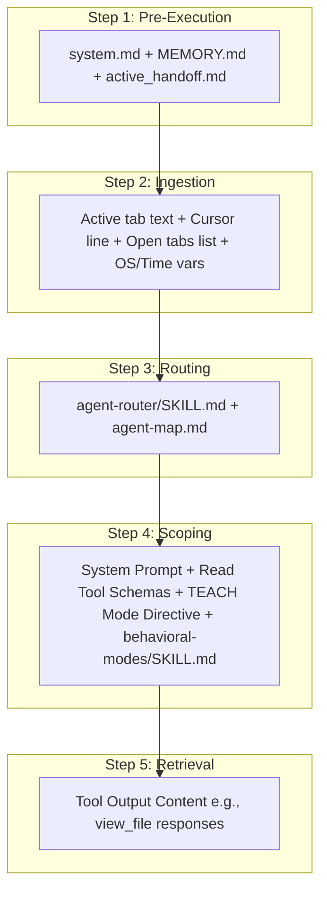

# SPEC-001a: QUESTION Path Context Trace

- **Status**: Approved
- **Author**: @orchestrator
- **Created**: 2026-06-24
- **Parent Spec**: [SPEC-001: Agent Context & Routing](index.md)

## 1. Overview
Trace of what is loaded in the AI context when handling informational questions or conceptual queries (e.g., "what is", "explain", "how does").

## 2. Detailed Context Loading Lifecycle

### Step 1: Pre-Execution & Rule Bootstrapping
Before your message text is even evaluated, the framework loads core workspace configuration files to establish system guidelines and check for active memory.

*   **Newly Loaded Context**:
    *   **Workspace Gateway Rules**: Appends [.agents/rules/system.md](/.agents/rules/system.md) as the `<user_rules>` block.
    *   **Memory Index**: Reads [docs/MEMORY.md](/docs/MEMORY.md) to discover currently pinned project files.
    *   **Handoff State**: Reads [docs/handoffs/active_handoff.md](/docs/handoffs/active_handoff.md) to check if the session was left in a pending or blocked state.
    *   **Global Rules**: Loads `AGENTS.md` (if configured in user home directory).

### Step 2: Client Metadata Ingestion
The IDE packages your message and appends the active editor state metadata to the context. All specific paths and file names are kept generic.

*   **Newly Loaded Context**:
    *   **Active File Path Variable**: `<path_to_active_file_in_workspace>`
    *   **Active File Content**: The full text (or a cursor-focused slice) of the active tab.
    *   **Cursor Position Variable**: `Cursor is on line: <line_number>`.
    *   **Editor Open Tabs Array**: List of currently open documents in the editor (e.g. `['<open_file_a.ext>', '<open_file_b.ext>', '<open_file_c.ext>']`).
    *   **Selected Text Variable**: Any text highlighted by your cursor in the editor.
    *   **System Environment Variables**: OS Type (e.g., `windows` or `linux`), Local Time (`YYYY-MM-DD-T...`), and Active Workspace Directory (`<workspace_root_path>`).

### Step 3: Classification & Routing Decision
The system initializes the router to determine how to process the request.

*   **Newly Loaded Context**:
    *   **Router Instructions**: Loads the [.agents/skills/agent-router/SKILL.md](/.agents/skills/agent-router/SKILL.md) guidelines.
    *   **Workspace Map**: Reads [.agents/agent-map.md](/.agents/agent-map.md) to parse available personas.
*   **Routing Execution**: The prompt is scanned for trigger keywords. Once classified as a **QUESTION**, the system decides **NOT** to load any specialized developer personas (e.g. `@engineer`, `@architect`) or developer execution skills (e.g. `git-worktree`), keeping the context clean.
    *   **Automatic ANALYSIS Escalation**: If the router detects that the query requires a deep, codebase-wide architectural audit (e.g. using keywords like *"explain in detail"*, *"deep dive"*, *"analyze"*, or *"review"*), the system automatically escalates the request to the **ANALYSIS** path. This boots the appropriate specialist persona and enables file-writing capabilities to generate a persistent report rather than responding inline in chat.
        *   **Mid-Execution Pivot**: If during Step 5 (Retrieval Loop) the agent discovers that the code complexity, dependency depth, or number of files involved is too large for a simple chat response, it can dynamically pivot mid-execution to the **ANALYSIS** path to write a persistent report.
        *   **Multi-Turn Q&A & Options Analysis Escalation**: During back-and-forth Q&A or option brainstorming, if the conversation shifts from conceptual teaching to formulating concrete system design patterns or architectural choices, the system escalates to the **ANALYSIS** (or **DESIGN**) path to persist the design decisions and trade-off tables in a version-controlled file.

### Step 4: Scoping & API Invocation
The backend configures the final prompt package and restricts active tools before calling the LLM.

*   **Newly Loaded Context**:
    *   **System Prompt**: The baseline `Antigravity` assistant identity.
    *   **Tool Schema Definitions**: Exposes *only* read-only tool schemas (`view_file`, `grep_search`, `list_dir`, `search_web`). Write/edit schemas (e.g., `write_to_file`, `replace_file_content`) are stripped out.
    *   **Behavioral Mode Instructions**: Injects instructions directing the LLM to adopt `TEACH` mode.
    *   **Behavioral Modes Formatting**: Loads [.agents/skills/behavioral-modes/SKILL.md](/.agents/skills/behavioral-modes/SKILL.md) formatting rules (specifically `Teach Mode` layout templates defined in `teach.md`). The final output produced by the LLM uses the formatting rules of this skill to structure the response.
    *   **Alignment Protocol (Vague/Ambiguous Queries)**: If the router detects at Step 3 that the query is ambiguous, it dynamically loads [.agents/skills/alignment-protocol/SKILL.md](/.agents/skills/alignment-protocol/SKILL.md). This instructs the LLM on when and how to prompt the user with a Socratic Gate check and structured option tables to clarify requirements before generating the final answer.

### Step 5: Retrieval Loop (On-Demand)
If the LLM decides it needs more codebase information to answer your question, it fetches it dynamically.

*   **Newly Loaded Context**:
    *   **Tool Output Context**: The text returned by any executed tools (e.g. file content retrieved by a `view_file` call or search result snippets from `search_web`). This is appended as a `tool_response` block in the LLM's message thread.

### Step 6: Post-Processing & Rendering
The LLM response is processed by the client.

*   **Newly Loaded Context**:
    *   **Client Render Variables**: The IDE loads the markdown parsing engine to render text, and runs regex scripts to convert relative references into clickable absolute file links. No new data is added to the LLM context.

---

> [!NOTE]
> **Traditional Agent Difference**:
> A traditional IDE agent will load all write/edit tools in the prompt for every question. This increases context bloat and often prompts the agent to write code changes or propose terminal commands when you only wanted a conceptual explanation.
