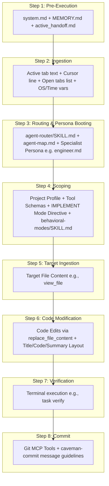

# SPEC-001d: SIMPLE CODE Path Context Trace

- **Status**: Approved
- **Author**: @orchestrator
- **Created**: 2026-06-24
- **Parent Spec**: [SPEC-001: Agent Context & Routing](index.md)


## 1. Overview
Trace of what is loaded in the AI context when performing small, localized code modifications (e.g., "add", "change" in a single file).

## 2. Detailed Context Loading Lifecycle



### Step 1: Pre-Execution & Rule Bootstrapping
Before evaluating the user's prompt text, the backend initializes the core system guidelines to retrieve workspace memory and restore execution state.

*   **Newly Loaded Context**:
    *   **Workspace Gateway Rules**: Appends [.agents/rules/system.md](/.agents/rules/system.md) as the `<user_rules>` block.
    *   **Memory Index**: Reads [docs/MEMORY.md](/docs/MEMORY.md) to discover currently pinned project files.
    *   **Handoff State**: Reads [docs/handoffs/active_handoff.md](/docs/handoffs/active_handoff.md) to check if the session was left in a pending or blocked state.
    *   **Global Rules**: Loads `AGENTS.md` (if configured in user home directory).

---

### Step 2: Client Metadata Ingestion
The IDE packages the active editor state metadata and local environment variables.

*   **Newly Loaded Context**:
    *   **Target Scope Variables**: Active file path, current tab content slice, and highlighted text selection.
    *   **Cursor Position Variable**: `Cursor is on line: <line_number>`.
    *   **Editor Open Documents Array**: Currently open tabs in the editor (e.g. `['<open_file_a.ext>', '<open_file_b.ext>']`).
    *   **System Environment Variables**: OS Type (`windows`/`linux`), local time, and workspace root directory.

---

### Step 3: Classification & Persona Booting
The system initializes the request classifier to scan prompt keywords.

*   **Newly Loaded Context**:
    *   **Router Instructions**: Loads [.agents/skills/agent-router/SKILL.md](/.agents/skills/agent-router/SKILL.md).
    *   **Workspace Agent Map**: Reads [.agents/agent-map.md](/.agents/agent-map.md) to parse available roles.
*   **Persona Selection**: The request is routed to the **SIMPLE CODE** path. The system dynamically boots the specialist persona:
    *   **`@engineer`**: Boots [.agents/personas/engineer.md](/.agents/personas/engineer.md) (with `git-worktree` and `behavioral-modes` skills).
*   **Trigger Notification Banner**: The agent informs the user of the resolved persona and request type using the banner:
    ```markdown
    🤖 **Applying knowledge of `@engineer` (SIMPLE CODE)...**
    ```

---

### Step 4: Scoping & API Invocation
The backend configures tool schemas and sets behavioral constraints. Since the request is simple and localized, **planning mode is bypassed** (no plan file creation required under `docs/plans/` and no Socratic gateway verification loops).

*   **Newly Loaded Context**:
    *   **System Prompt**: Injects `@engineer` persona instructions.
    *   **Project Profile**: Reads [project_profile.md](/docs/project_profile.md) (if it exists) to extract stack, rules, and compilation tasks.
    *   **Tool Schema Restrictions**: Exposes standard code modification schemas (preferring `replace_file_content` over full-file writes) and terminal execution schemas (`run_command`).
    *   **Behavioral Mode Instructions**: Injects instructions directing the LLM to adopt `IMPLEMENT` mode.
    *   **Behavioral Modes Formatting**: Loads [.agents/skills/behavioral-modes/SKILL.md](/.agents/skills/behavioral-modes/SKILL.md) and imports the `IMPLEMENT` layout template from [.agents/skills/behavioral-modes/templates/implement.md](/.agents/skills/behavioral-modes/templates/implement.md).
    *   **Critical Constraints**: Enforces no tutorial-style explanations, keeps conversational text surrounding code blocks under 2 sentences max, and ensures code is self-documenting (no unnecessary comments).

---

### Step 5: Target Ingestion (On-Demand)
The LLM fetches the exact file content of the target file to be modified.

*   **Newly Loaded Context**:
    *   **Tool Output Context**: Appends the text returned by `view_file` for the target file directly into the LLM context.

---

### Step 6: Code Modification & Reporting
The agent proposes and writes the code modification to the file.

*   **Execution**:
    *   **Code Modification Tooling**: Proposes and applies the edit using `replace_file_content` targeting the specific contiguous line block to modify.
    *   **Structured Reply Layout**: Outputs a concise reply matching the `IMPLEMENT` layout:
        *   **[Implementation Title]**
        *   **Code Changes** (represented in a markdown fenced code block or diff)
        *   **Technical Summary** (brief 1-2 sentence description)

---

### Step 7: Verification & Testing
> **Lifecycle Stage**: Inline verification (does **not** activate the full [SPEC-002](../workflow-protocol/index.md) lifecycle — no formal Stage 1 planning gate)

The agent runs verification checks to ensure that the change successfully compiles and doesn't break tests.

*   **Execution**:
    *   Runs the workspace verification command (e.g. `task verify` as defined in [Taskfile.yml](/Taskfile.yml)).
    *   If compile errors or test failures occur, the agent repeats edits until all checks pass.

---

### Step 8: Version Control & Commit
The verified changes are staged and committed to version control.

*   **Execution**:
    *   Stages modified files.
    *   Generates a conventional commit message (using `caveman-commit` skill rules if active).
    *   Commits the changes.

---

> [!NOTE]
> **Traditional Agent Difference**:
> Traditional agents frequently perform full-file rewrites (dumping the entire file to write 2 new lines), wasting token bandwidth, slowing down response times, and risking accidental truncation or deletion of unrelated code block regions. They also generate verbose, tutorial-like explanations that clutter the chat history.
