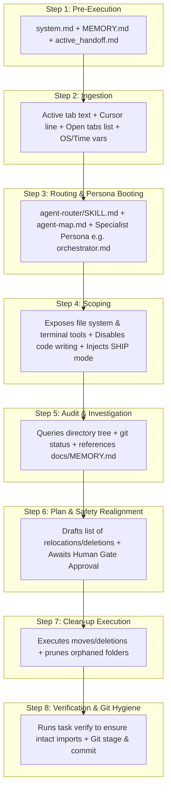

# SPEC-001j: TECH DEBT REDUCTION Path Context Trace

- **Status**: Approved
- **Author**: @orchestrator
- **Created**: 2026-06-24
- **Parent Spec**: [SPEC-001: Agent Context & Routing](index.md)


## 1. Overview
Trace of what is loaded in the AI context when managing repository files, cleaning directories, renaming assets, or maintaining workspace hygiene (e.g. "clean scratch folder", "move files", "rename folder").

## 2. Detailed Context Loading Lifecycle



### Step 1: Pre-Execution & Rule Bootstrapping
Before evaluating the user's prompt text, the backend initializes the core system guidelines to retrieve workspace memory and restore execution state.

*   **Newly Loaded Context**:
    *   **Workspace Gateway Rules**: Appends [.agents/rules/system.md](/.agents/rules/system.md) as the `<user_rules>` block.
    *   **Memory Index**: Reads [docs/MEMORY.md](/docs/MEMORY.md) to discover currently pinned project files.
    *   **Handoff State**: Reads [docs/handoffs/active_handoff.md](/docs/handoffs/active_handoff.md) to check if the session was left in a pending or blocked state.
    *   **Global Rules**: Loads `AGENTS.md` (if configured in user home directory).

---

### Step 2: Client Metadata Ingestion
The IDE packages the active editor state metadata and local environment variables.

*   **Newly Loaded Context**:
    *   **Target Scope Variables**: Active file path, current tab content slice, and highlighted text selection.
    *   **Cursor Position Variable**: `Cursor is on line: <line_number>`.
    *   **Editor Open Documents Array**: Currently open tabs in the editor (e.g. `['<open_file_a.ext>', '<open_file_b.ext>']`).
    *   **System Environment Variables**: OS Type (`windows`/`linux`), local time, and workspace root directory.

---

### Step 3: Classification & Persona Booting
The system initializes the request classifier to scan prompt keywords and boot the coordinator.

*   **Newly Loaded Context**:
    *   **Router Instructions**: Loads [.agents/skills/agent-router/SKILL.md](/.agents/skills/agent-router/SKILL.md).
    *   **Workspace Agent Map**: Reads [.agents/agent-map.md](/.agents/agent-map.md) to parse available roles.
*   **Persona Selection**: The request is routed to the **TECH DEBT REDUCTION** path. The system boots the coordinator persona:
    *   **`@orchestrator`**: Boots [.agents/personas/orchestrator.md](/.agents/personas/orchestrator.md) (with `git-worktree` and `behavioral-modes` skills).
*   **Trigger Notification Banner**: The agent informs the user of the resolved persona and request type using the banner:
    ```markdown
    🤖 **Applying knowledge of `@orchestrator` (TECH DEBT REDUCTION)...**
    ```

---

### Step 4: Scoping & API Invocation
The backend configures tool schemas and sets behavioral constraints.

*   **Newly Loaded Context**:
    *   **System Prompt**: Injects `@orchestrator` coordinator rules.
    *   **Tool Schema Restrictions**: Exposes file system management tools (moving, renaming, deleting) and shell execution commands (`run_command` to list directory trees, check git status, or prune), but **disables code editing/writing tools** (like `replace_file_content` or `multi_replace_file_content`) to prevent code mutations during organization tasks.
    *   **Behavioral Mode Instructions**: Injects instructions directing the LLM to adopt `SHIP` mode.

---

### Step 5: Workspace Audit & Investigation
The `@orchestrator` inspects the directory trees and checks file tracking status.

*   **Execution**:
    *   **Audit Directory Structure**: Runs `list_dir` or directory listing shell commands to search for scratch files, untracked templates, and unneeded temporary outputs.
    *   **Verify Git Status**: Runs shell commands to inspect `git status` and locate ignored or untracked changes.
    *   **Inspect Memory**: Checks `docs/MEMORY.md` to ensure that no critical specifications or active ADRs are deleted or moved incorrectly.

---

### Step 6: Plan Formulation & Safety Realignment
Since bulk file moves/deletions have a blast radius (breaking package references or deleting uncommitted changes), the agent outlines the proposed updates.

*   **Execution**:
    *   **Draft Proposals**: Lists the specific files to delete, move, or rename.
    *   **Approval Gate**: Prompts the user with the proposal in the chat and pauses execution, awaiting confirmation before performing actions.

---

### Step 7: Clean-up & Relocation Execution
Upon human approval, the agent executes the workspace clean-up actions.

*   **Execution**:
    *   Moves, renames, or deletes files.
    *   Prunes orphaned directories and clears temp folders.

---

### Step 8: Verification & Git Hygiene
The agent verifies workspace health and commits the organization task.

*   **Execution**:
    *   Runs compilation and tests (`task verify` or equivalent) to confirm that no import links or project configs were broken during the relocations.
    *   Stages the modified/relocated files under Git.
    *   Commits with a descriptive Conventional Commit message (e.g. `refactor: clean workspace hygiene`).

---

> [!NOTE]
> **Traditional Agent Difference**:
> Traditional agents do not verify repository status or workspace hygiene before performing bulk file relocations or deletions. They may delete uncommitted code, leave orphaned directories behind, or fail to track changes under version control.
