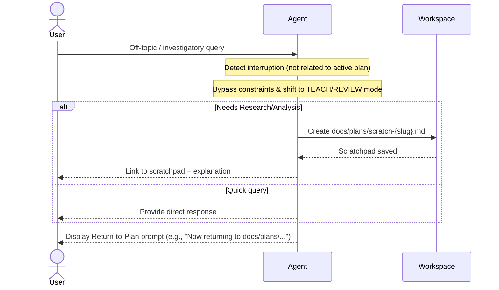

# SPEC-002e: Escape Hatch Rule Specification

- **Status**: Approved
- **Author**: @orchestrator
- **Created**: 2026-06-27
- **Parent Spec**: [SPEC-002: Agent Workflow Protocol Specification](index.md)

## 1. Overview
During active implementation lifecycles, users frequently pivot or ask unrelated, exploratory, or teaching questions (e.g. *"Explain how our router works"* or *"What libraries are installed?"*). The Escape Hatch Rule outlines the protocol for handling these interruptions cleanly without polluting the active implementation plan or breaking context state.

## 1.1 Routing Interaction
When the Escape Hatch fires, the agent temporarily yields control back to `agent-router` ([SPEC-001](../agent-context-routing/index.md)) to re-classify the off-topic query (typically as QUESTION or ANALYSIS). The active lifecycle state is preserved and restored after the interruption.

## 2. Interrupt Management Flow

### Steps:
1.  **Bypass Phase Constraints**:
    *   Temporarily suspend the active coding stage directives.
    *   Transition behavior to `TEACH` or `REVIEW` mode to address the user's inquiry directly.
2.  **Separate Artifacts**:
    *   If the question demands a formal review or analysis, write findings to a scratchpad file (e.g., `docs/plans/scratch-{slug}.md`).
    *   Do NOT modify or pollute the active `implementation_plan-*.md` or `task-*.md` files.
3.  **Remind User of Plan Status**:
    *   End the response with a clear pointer back to the active plan:
        > *"Now returning to the active planning workflow under `docs/plans/...`"*

---

> [!NOTE]
> **Traditional Agent Difference**:
> Traditional IDE assistants either ignore off-topic queries to stick dogmatically to code changes, or get distracted and lose the context of the active plan entirely, requiring the user to re-upload files and re-explain the task.
