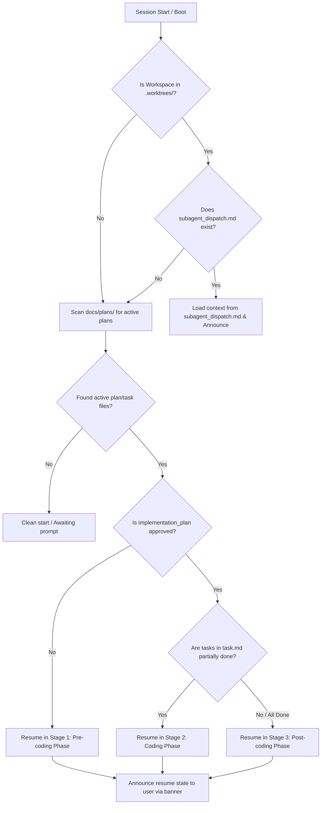

# SPEC-002d: Session Resume Specification

- **Status**: Approved
- **Author**: @orchestrator
- **Created**: 2026-06-27
- **Parent Spec**: [SPEC-002: Agent Workflow Protocol Specification](index.md)

## 1. Overview
AI agent sessions are inherently stateless. To maintain workflow continuity across different chat sessions, IDE restarts, or handoffs, this specification outlines the session boot sequence that checks for active plans and restores state automatically.

## 1.1 Precedence
Session Resume runs **before** `agent-router` request classification ([SPEC-001](../agent-context-routing/index.md)). If an active plan is detected, the classification step is bypassed and the agent resumes at the appropriate lifecycle stage.

## 2. Boot Verification Lifecycle

### Steps:
1.  **Worktree Check**:
    *   Verify if the working directory is structured inside a git worktree (`.worktrees/`).
    *   If a worktree context exists, inspect `docs/handoffs/subagent_dispatch.md` to restore specific subagent parameters and suppress global main-branch ticket context.
2.  **Scan Workspace**:
    *   Search the `docs/plans/` directory for active `implementation_plan-*.md` or `task-*.md` files.
3.  **Determine Current State**:
    *   Assess the status of the plan:
        *   Plan exists but lacks approval (or is in draft/review state) ➔ **Stage 1 (Pre-coding)**.
        *   Plan is approved and some tasks are not checked off ➔ **Stage 2 (Coding)**.
        *   All implementation tasks are complete but not verified ➔ **Stage 3 (Post-coding)**.
4.  **Announce State**:
    *   Print a clear console notification to the user identifying the resumed stage.

---

> [!NOTE]
> **Traditional Agent Difference**:
> Traditional IDE assistants start with a blank state in every conversation. They cannot detect workspace files, local plan states, or active tasks, forcing the user to manually copy-paste files and re-explain current progress in every new session.
