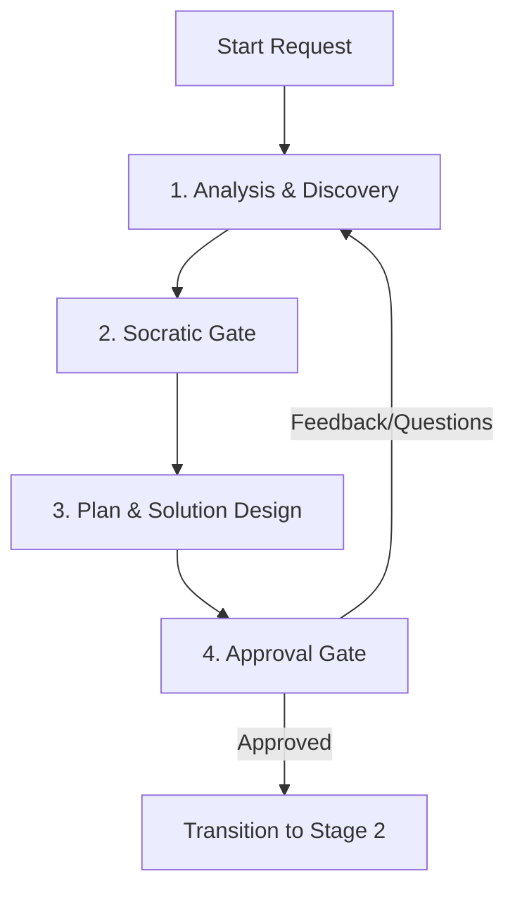

# SPEC-002a: Stage 1: Pre-coding Phase Specification

- **Status**: Approved
- **Author**: @orchestrator
- **Created**: 2026-06-27
- **Parent Spec**: [SPEC-002: Agent Workflow Protocol Specification](index.md)

## 1. Overview
Stage 1 (Pre-coding) is the planning, discovery, and design alignment phase. The main goal of this stage is to thoroughly understand the codebase context, map dependencies, address ambiguity through structured options, and obtain explicit user approval before modifying any implementation or source code.

## 1.1 Activated By
This stage is entered when `agent-router` classifies a request as:
- [SPEC-001e: COMPLEX CODE Path](../agent-context-routing/complex-code-path.md) → Step 5
- [SPEC-001f: DESIGN/UI Path](../agent-context-routing/design-ui-path.md) → Steps 5–8

## 2. Core Workflow Steps

### 1. Analysis & Discovery
*   **Actions**:
    *   Inspect codebase files, directories, configurations, and packages.
    *   Query and load relevant Knowledge Items (KIs).
    *   Read the project profiles, `docs/MEMORY.md`, and `docs/handoffs/active_handoff.md`.
*   **Restrictions**: No modification to source files or execution of code-modifying commands.

### 2. Socratic Gate
*   **Actions**:
    *   Identify ambiguous, complex, or high-risk requirements.
    *   Formulate options, trade-offs, and risk matrices.
    *   Initiate Socratic questioning (optionally using the `/grill-me` interface) to resolve design choices.

### 3. Plan & Solution Design
*   **Actions**:
    *   Create a detailed implementation plan at `docs/plans/implementation_plan-{slug}.md` and a task checklist at `docs/plans/task-{slug}.md`.
    *   Outline structural modifications, dependencies, and affected components without writing extensive code blocks.
    *   Define verification methods and unit test runners to validate changes.

### 4. Approval Gate
*   **Actions**:
    *   Present the plan to the user.
    *   **Pause execution**: Remain in Stage 1. Do NOT proceed to write code or update files until the user explicitly approves the plan.
    *   *Note*: Questions, inline reviews, or design feedback do not qualify as approval. Only an explicit proceed/approve signal satisfies the gate.

---

## 3. Specialist Plug-ins
*   **`@architect`**: Invoked for API schema design, database migrations, and structural abstractions.
*   **`@legacy-analyst`**: Invoked to map patterns in legacy, undocumented, or complex repositories.
*   **`@security-reviewer`**: Invoked for threat modeling, permission scope reviews, and security compliance checks.

---

> [!NOTE]
> **Traditional Agent Difference**:
> Traditional IDE assistants skip Stage 1 entirely, starting to write code immediately upon receiving a prompt. This lack of discovery and gating leads to high code churn, incorrect design assumptions, and broken codebase states.
