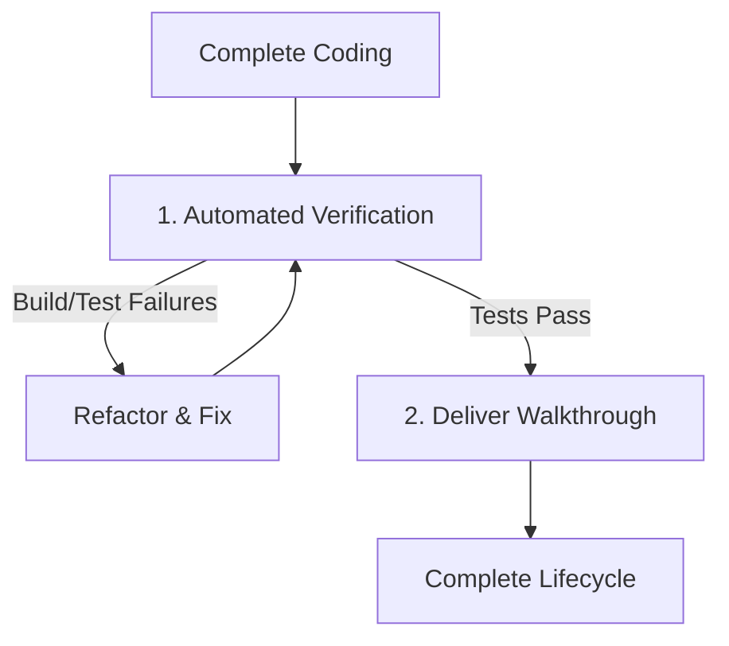

# SPEC-002c: Stage 3: Post-coding Phase Specification

- **Status**: Approved
- **Author**: @orchestrator
- **Created**: 2026-06-27
- **Parent Spec**: [SPEC-002: Agent Workflow Protocol Specification](index.md)

## 1. Overview
Stage 3 (Post-coding) is the verification and delivery phase. This stage focuses on proving correctness through execution and structured testing rather than simple visual inspection, culminating in a detailed walkthrough report.

## 1.1 Activated By
This stage is entered after Stage 2 completion, when executing:
- [SPEC-001e: COMPLEX CODE Path](../agent-context-routing/complex-code-path.md) → Step 7
- [SPEC-001f: DESIGN/UI Path](../agent-context-routing/design-ui-path.md) → (post-handoff to COMPLEX CODE)

## 2. Core Workflow Steps

### 1. Automated Verification
*   **Actions**:
    *   Execute test runners, compiler commands, and linters (e.g., via `task verify` or custom test runners).
    *   Capture terminal stdout/stderr for inclusion in the verification report.
    *   If errors occur, revert or patch changes and re-run verification until all gates pass.

### 2. Deliver Walkthrough
*   **Actions**:
    *   Create or update `docs/plans/walkthrough-{slug}.md` summarizing the modifications.
    *   Include a **Change Registry** listing files changed and their details.
    *   Embed verification test output logs.
    *   Embed screenshots or browser interaction recordings for user interface modifications.
    *   Conduct a self-review ensuring no temporary scratch files remain.

---

## 3. Specialist Plug-ins
*   **`@qa-tester`**: Invoked to run unit, integration, and end-to-end tests and generate reports.
*   **`@security-tester`**: Invoked to run dependency vulnerability audits or static application security testing (SAST) tools.
*   **`@seo-verifier`**: Invoked to run lighthouse or custom checks evaluating page metadata, responsiveness, and headers.

---

> [!NOTE]
> **Traditional Agent Difference**:
> Traditional IDE assistants declare a task complete as soon as they finish typing the code. They do not run compiler checks, linters, or test suites, leaving syntax errors, runtime crashes, and broken dependencies for the human developer to find and fix.
