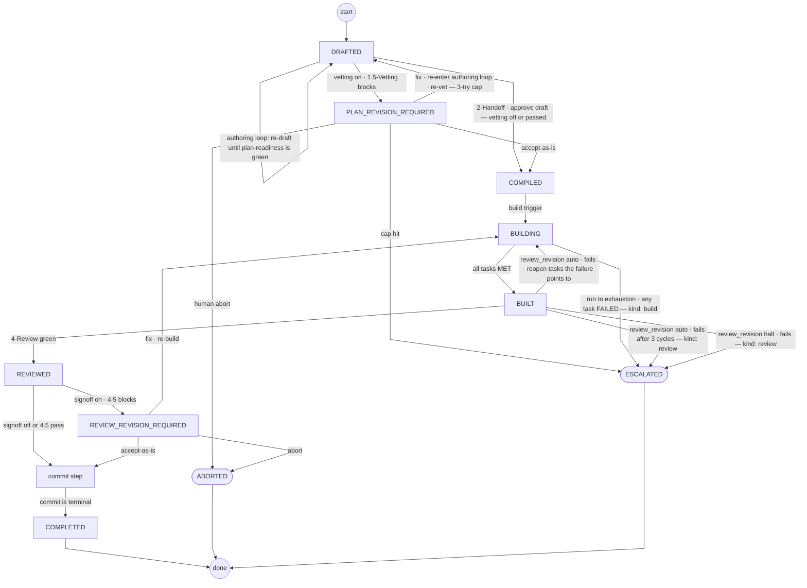
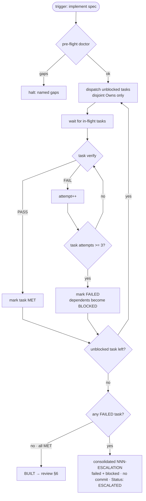
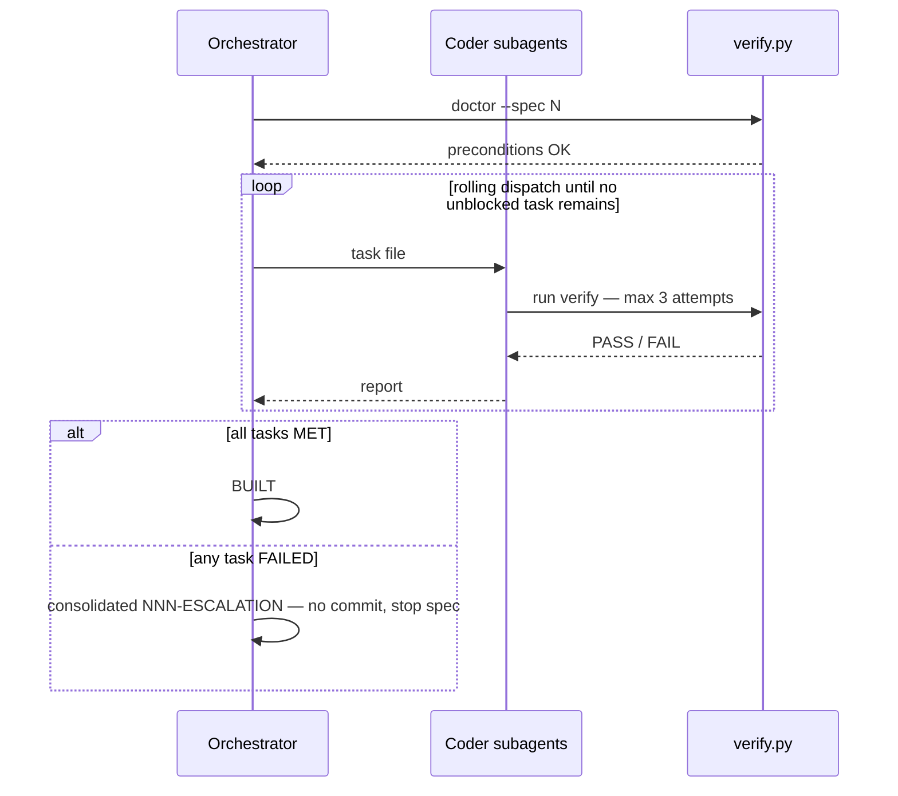
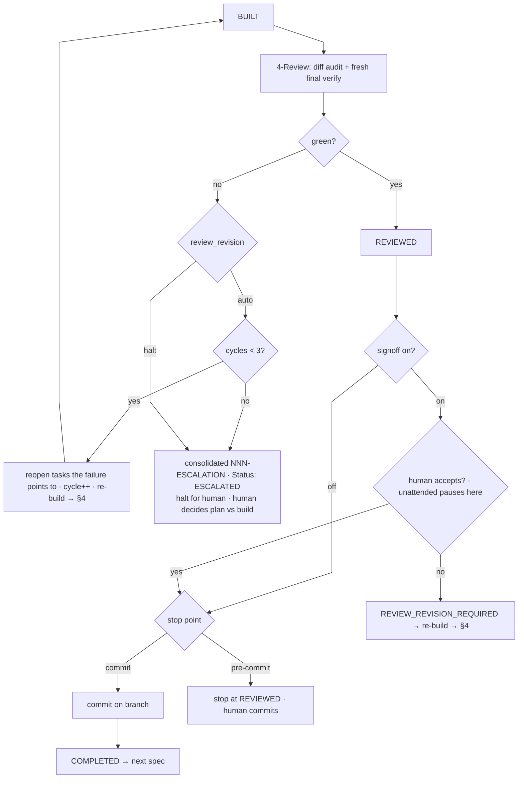
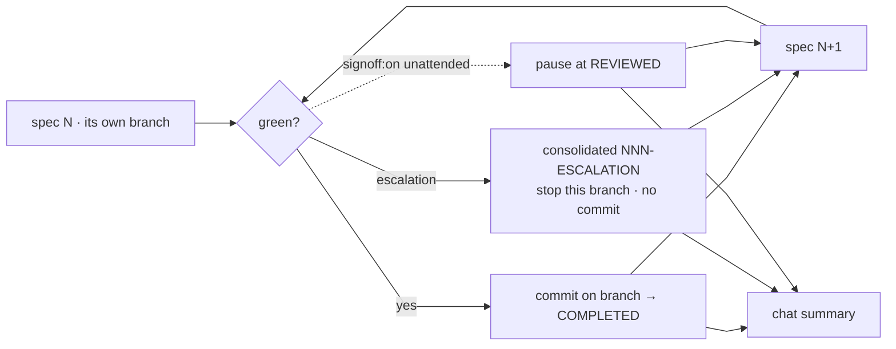

# Flow Design — all cases (scratch)

> Companion to `draft-plan.md`. Groups every open **flow** question in one place and maps
> the branches across: supervised vs unattended, review vs no-review, review pass vs fail,
> multi-spec, and escalation. Diagrams show the current design; open items are listed in §8.

## 1. The variables that pick the branch

| Variable | Values | Effect |
| :--- | :--- | :--- |
| **Trigger** | free-form text | Resolves the **run contract**; the framework never self-starts (opt-in = the cost gate) |
| targets | this / list / all | Which specs run (each must be `COMPILED`) |
| mode | `supervised` / `unattended` | Default from auto-router session type (Interactive → supervised, Non-Interactive → unattended; no signal → unattended). Trigger may override both ways |
| stop point | `commit` (default) / `pre-commit` | `commit` → commit + `COMPLETED`; `pre-commit` → stop at `REVIEWED` for the human |
| Lane | A/B (has spec) / C (no spec) | Whether 3-Build/4-Review run at all |
| 1.5-Vetting | header flag `vetting: on\|off` | Whether a fresh critic gates "approve draft" |
| 4.5-Sign-off | header flag `signoff: on\|off` | Human decides at REVIEWED (on) or auto-commits (off); in `unattended` mode `on` **pauses** at 4.5 |
| Review revision | header flag `review_revision: auto\|halt` | `auto` = ≤3 re-build cycles; `halt` = straight to human |
| Branching | specs on `main`; run branch per spec off `main` (+worktree) | Never code on `main`; escalation stops that spec's branch; the batch continues |

## 2. Flow issues (one group)

**F1 — Build trigger (resolved).** Free-form; both "approve handoff" and `implement <spec>`
are accepted (and either may be reworded) — the LLM resolves intent. One transition:
`COMPILED → BUILDING`.

**F2 — Review: when / when not (resolved).** 4-Review always runs for every Lane A/B spec (it
is the completion gate) and never for Lane C/D.

**F3 — Review fails → where? (resolved).** All tasks MET individually but the combined result
fails. `review_revision: auto` reopens the tasks the failure points to and re-builds up to 3
cycles; `halt` goes straight to the human. Either way it ends at a human (plan-level), recorded
in the consolidated `NNN-ESCALATION` (`kind: review`); naming which tasks is the human's call.

**F4 — Acceptance (resolved).** Commit is terminal: a green reviewed spec commits on its
branch and is stamped `COMPLETED` immediately — no separate acceptance, no second commit.
Only `stop point: pre-commit` leaves a spec at `REVIEWED` for the human to commit.

**F5 — 4.5-Sign-off in unattended (resolved).** `signoff: on` **pauses at `REVIEWED`** until a
human signs off; no autonomy shortcut, never auto-waived.

**F6 — 1.5-Vetting in unattended (resolved).** Vetting is decided at draft time by the
`vetting` flag; an unattended run starts only on an already-`COMPILED` spec, which may or may
not have been vetted — a planning-time choice, not a run-time one.

**F7 — Escalation semantics (revised).** No breaker. The build runs the DAG to exhaustion: a
task that uses its 3 attempts is `FAILED`, its dependents are `BLOCKED`, independent tasks
keep running, and only when nothing is unblocked do we decide. If any task `FAILED` → **one
consolidated `NNN-ESCALATION`** (every failed task with its 3 attempts, every blocked task),
no commit, no revert, dirty tree; the spec parks as **`ESCALATED`**. Resume re-dispatches only
the `FAILED`/`BLOCKED` tasks (a fixed dependency unblocks its dependents). The escalation doc
carries `kind: build | review`.

**F8 — Resume at a boundary.** Resume entrypoints: `DRAFTED` → re-enter 1-Plan; `COMPILED` →
3-Build; `BUILT` → 4-Review; a `pre-commit` spec (`REVIEWED`) → human commits; `ESCALATED` →
re-dispatch failed/blocked tasks or re-plan.

**F9 — Commit vs COMPLETED vs 4.5 (resolved).** `4.5` sits *before* the commit; then commit →
`COMPLETED` immediately (terminal). No post-commit checks.

**F10 — Multi-spec (resolved).** One branch per spec; an escalation stops **that spec's
branch** and the batch **continues**; the batch ends with a report.

**F11 — Parallel dispatch boundary (resolved).** Overlapping `Owns` sets are never dispatched
**concurrently** (serialized by `Depends On`); they may still run in the same spec.

**F12 — Review scope.** 4-Review reads "the built diff + the spec". Where are the `R#`
outcome observations recorded (run report / task file / spec §5), and what does
reconciliation do on a missing observation — fail the review, or park in `BACKLOG.md`?

## 3. Master per-spec state machine

**Two distinct failure sources feed `ESCALATED`** (`ABORTED` is reserved for a human
deliberately stopping a spec). *Build red* = some task exhausted its 3 attempts (a unit failed;
escalation `kind: build`). *Review red* = every task passed but the **combined** result failed
— integration, drift (`STALE` evidence), or an unobserved `R#` (escalation `kind: review`).
Only review red has the 3-cycle repair loop; build red exits straight to `ESCALATED`.

## 3b. The two planning loops (do not conflate them)

- **Authoring loop (internal to 1-Plan, `DRAFTED` self-loop).** The planning agent keeps
  revising `specs/temp/draft-plan.md` until **every goal is captured, every internal
  inconsistency removed, every open decision made, and every ambiguity resolved**. Nothing
  leaves this loop; no status changes; it is just the plan being iterated. `DRAFTED` means
  "still authoring or ready to author-approve", never "published".
- **The shared plan-readiness checklist.** Both the authoring loop and vetting test the same
  things: (1) every goal captured, (2) no internal inconsistency, (3) every decision made,
  (4) every ambiguity resolved — **plus** the engine checks: the verify/expect lint and
  §2.7 "every outcome has an owner task". Vetting is just an *independent* run of this
  checklist by someone who did not author the plan.
- **1.5-Vetting loop (the optional gate on top).**
  - **Trigger.** The draft-time header flag `vetting: on|off` (default on for a Lane-A
    surface, off otherwise; token cost).
  - **Verdict.** *Pass* → no status change (gate-log entry), feeds "approve draft". *Block* →
    `PLAN_REVISION_REQUIRED` (gate-log entry records the issues), drops the plan back into
    the authoring loop where goals/decisions/tasks may be **removed or changed**.
  - **Re-run.** After any fix, vetting runs **again** (fresh critics). Any draft edit after a
    *pass* **invalidates** that pass → re-vet, or explicitly waive.
  - **Termination.** Bounded by the **same 3-try exit as a task's verify** (3 blocks →
    escalate/abort) **and** by human control (the human may accept-as-is or abort at any
    round), instead of looping forever.
  - **Exits.** pass (`COMPILED`), accept-as-is (waive → `COMPILED`, park unresolved issues in
    `BACKLOG.md`), abort (`ABORTED`).
- **4.5-Sign-off gate (optional).** Controlled by `signoff: on|off`. It is **only the human's
  decision** on the reviewed result — no second critic (4-Review already did the automated
  audit + fresh final verify). `signoff: off` → auto: `REVIEWED` commits straight to
  `COMPLETED`. `signoff: on` → wait for the human: accept → commit → `COMPLETED`, request
  changes → `REVIEW_REVISION_REQUIRED` → re-build. `signoff: on` declares a human is part of
  the run.
- **Vetting never authors, and never promotes.** A pass is advisory input to the human's
  "approve draft"; the status changes only at 2-Handoff. Unattended runs start only on an
  already-`COMPILED` spec, so there is **no** autonomous "approve draft" (D9).

Two paths converge: `authoring → [vetting pass] → approve draft → COMPILED` or
`authoring → approve draft → COMPILED`. The authoring loop is where "fix the
inconsistencies/ambiguities/decisions" work happens — exactly what we are doing to this spec
now.

## 4. Build run flow (COMPILED → BUILT | ESCALATED)

The build loop is **run-to-exhaustion**: a task that exhausts its 3 attempts is marked
`FAILED`, its dependents become `BLOCKED`, and every other independent task still runs
(exhaustion is never declared while tasks are in flight). Only when no unblocked task remains
is the outcome decided — all MET → `BUILT`, otherwise **one consolidated** `NNN-ESCALATION`
for the spec (all failed tasks with their attempts + all blocked tasks) and the spec halts as
`ESCALATED`. There is no "3 consecutive failed tasks" breaker.

## 5. Build loop (identical for supervised and unattended)

## 6. Review & acceptance (BUILT → REVIEWED → commit → COMPLETED)

A review failure (every task MET but the **combined** result fails) is a **plan-level
signal**. With `review_revision: auto` it gets up to 3 re-build cycles; with `halt` it goes
straight to the human. Either way the terminal state is `ESCALATED` + human intervention —
regardless of session — and the human decides whether the fix belongs in the plan or the
build. `signoff: on` makes the human decide at `REVIEWED` (accept → commit → `COMPLETED`, or
request changes → re-build); `signoff: off` auto-commits. In `unattended` mode, `signoff: on`
just **pauses at 4.5** until a human signs off — it is never auto-waived.

**Verification ladder (2 levels).** (1) **Per-task verify** — inside the build, each task has
1 scoped verification with a 3-attempt limit. (2) **4-Review** — the cross-task level: a
fresh re-run of every task's verify + the canonical commands, plus the diff audit. Subtasks
carry **no** verify (generation-time guidance only). Only level 2 sees the tasks combined, so
integration failures surface there.

## 7. Multi-spec + escalation flow

The run is **commit-terminal**: a green spec commits on its own branch and is `COMPLETED`
immediately (no post-commit checks); a `signoff: on` spec pauses at `REVIEWED` and the batch
moves on; an escalation stops only that spec's branch. Reports are **per spec only** (each
`NNN-REPORT`) — there is no combined batch file; the batch ends with a **chat summary**. The
run never merges to the default/release branch (hard guardrail).

## 8. Decision log

- **Run contract** — **decided**: targets / mode / stop point resolved from the trigger; mode
  default from the auto-router session type (Option A); the framework never self-starts (opt-in
  = the cost gate).
- **D1** **Decided**: a failed/escalated spec parks as **`ESCALATED`**; `ABORTED` is reserved
  for a human deliberately stopping a spec at a gate. Human decides next.
- **D2** Review-failure routing **decided**: `review_revision: auto` = ≤3 re-build cycles then
  halt for human; `halt` = straight to human. A plan-level signal.
- **D3** `signoff: on` in `unattended` mode **pauses at 4.5** (no autonomy shortcut).
- **D4** Escalation stops **that spec's branch**; the batch continues (one branch per spec).
- **D5** Resumed-run acceptance: commit → `COMPLETED` immediately; only `pre-commit` leaves a
  `REVIEWED` spec for a human to commit.
- **D6** Commit is terminal; the run contract's stop point (`commit` / `pre-commit`) decides.
  No post-commit checks.
- **D7** "same run" ownership = concurrent-only (serialized by `Depends On`).
- **D8** **Decided**: `R#` observations go in the run report (`NNN-REPORT`), one line each; a
  missing observation fails 4-Review (→ the review-failure path).
- **D9** **Resolved**: unattended runs start only on already-`COMPILED` specs — no autonomous
  "approve draft".
- **D10** Vetting cap = 3-try exit + human control; cap-hit → `ESCALATED`.
- **D11** Vetting trigger = draft-time flag `vetting: on|off`.
- **Backlog lifecycle** — **decided**: the human owns it (agents add/propose; only the human
  closes an entry).
- **Branching** — **decided**: specs live on `main`; a run creates one branch per spec off
  `main` (+worktree) and never edits `main`; merge is human-only.
- **Review re-build** — **decided**: a combined failure always ends at a human (`kind: review`
  escalation). `review_revision: auto` may try ≤3 re-builds first; picking which tasks is a
  human call.
- **Approvals store** — **decided**: gitignored / per-clone (a record, not the gate); real
  execution permission is the harness's.
- **Commit contents** — **decided**: planning commit = spec + task files (on `main`); run
  commit = code (+ task files + report) on the spec branch.
- **Approval fingerprint** — **decided**: `command | expect | cwd` (no `executor`).
- **Doctor checklist** — **decided**: 9 ordered per-spec checks; per-task `doctor:` optional.
- **Vetting mechanics** — **deferred** (not blocking; `vetting` defaults off).
